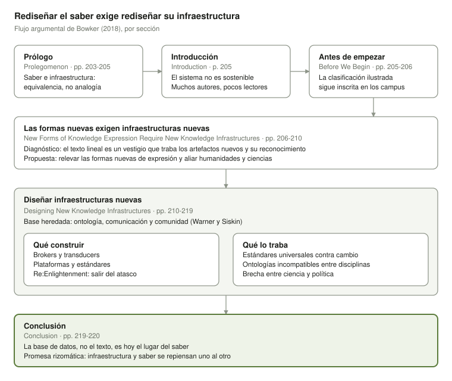

# Bowker (2018) — Sustainable knowledge infrastructures: resumen operativo

El capítulo sostiene que las infraestructuras del conocimiento son infraestructuras en sentido pleno, y que la que heredamos de la Ilustración ya no es sostenible. Propone diseñar a la vez nuevas formas de expresar el conocimiento y nuevas infraestructuras para producirlo, porque ninguna cambia sin la otra.

**Referencia:** Bowker, G. C. (2018). Sustainable knowledge infrastructures. En N. Anand, A. Gupta y H. Appel (Eds.), *The promise of infrastructure* (pp. 203-222). Duke University Press.

Ojo: no es un capítulo del *Companion* de Harvey, Jensen y Morita, sino de *The Promise of Infrastructure*. Las afirmaciones van parafraseadas, con la página de la edición publicada; en este PDF el número de página va al pie, y la primera página de texto abarca las pp. 203-204.

## Objetivos y estrategia retórica

### Objetivo general

El capítulo busca mostrar que el sistema académico de producción de conocimiento es una infraestructura que hay que rediseñar para que sea sostenible (pp. 205, 208). El conocimiento actual está "atascado" en formas heredadas de la Ilustración: disciplinas, texto lineal y una comunidad de lectores pequeña.

Lo que está en juego es la relación entre cómo habitamos el mundo y cómo lo pensamos. Bowker la trata como una equivalencia formal, no como una analogía (pp. 203-205).

### Objetivos específicos

1. Justificar que las infraestructuras del conocimiento pertenecen a la misma familia que caminos, tuberías o redes eléctricas, con una definición relacional de infraestructura (pp. 203-204).
2. Establecer una equivalencia formal entre las formas de energía e infraestructura de una sociedad y sus teorías sobre el mundo (pp. 203-205).
3. Diagnosticar por qué el sistema académico no es sostenible: demasiados productores, pocos lectores y un saber parcelado frente a los problemas del Antropoceno (p. 205).
4. Historizar ese sistema: la clasificación ilustrada del saber, inscrita incluso en la planta de los campus, y sus tres ejes de ontología, comunicación y comunidad (pp. 205-206, 210-211).
5. Proponer una estrategia: relevar las nuevas formas de expresar conocimiento, aliar humanidades y ciencias, formar nuevos trabajadores del conocimiento y pensar en plataformas y estándares (pp. 208, 211-215).
6. Señalar las tensiones que traban ese diseño: estándares frente a cambio, ontologías incompatibles, mantenimiento y brecha entre ciencia y política (pp. 217-219).
7. Cerrar con una inversión: la base de datos, no el texto, es hoy el lugar del conocimiento, y la promesa de la infraestructura debe ser rizomática (pp. 219-220).

### Estrategia retórica general

- **Triple comienzo.** Un prólogo, una introducción y un "antes de empezar". La nota 1 lo presenta como homenaje a *Mal de archivo* de Derrida: a la infraestructura solo se entra desde varios ángulos a la vez (p. 220).
- **Manifiesto programático.** Predomina el "necesitamos" y el "propongo" en primera persona. El texto argumenta qué hacer más que describir un caso.
- **De la analogía a la equivalencia.** Bowker declara que no le basta una analogía "marginalmente robusta" entre saber e infraestructura: busca una equivalencia (p. 204). Esa apuesta ordena el resto del capítulo.
- **Genealogía como argumento.** Comte y Ampère, la palabra "scientist" en la década de 1830, la fábrica de Bacon. La historia sirve para mostrar que la forma actual del saber es contingente y que ya se trabó antes.
- **Erudición en cadena.** El capítulo encadena muchas referencias breves: Serres, Mitchell, Kurke, Sohn-Rethel, Kuhn, Latour, Whitehead, Gillespie, Benjamin. Prima la amplitud sobre el análisis detenido de cada una.
- **Ejemplos en lugar de casos.** Los campus de Illinois e Irvine, la revista Vectors, YouTube, los registros de sida, el GBIF. Ilustran, pero no hay trabajo de campo sistemático.
- **Diálogo con el volumen y con Star.** Responde a la introducción de Appel, Anand y Gupta sobre la "promesa" de la infraestructura. Se apoya en Star y Ruhleder (1996), en Star ([1995] 2016) y en Bowker y Star sobre clasificación.
- **Optimismo con freno.** Defiende el optimismo de Bacon, pero critica el entusiasmo tecnológico de Nielsen y Shirky con una imagen: se enamoran de la primera cita y no ven el matrimonio (p. 217).

## Recorrido sección por sección

El capítulo tiene seis partes. Las tres primeras fijan la equivalencia y el diagnóstico, las dos centrales proponen y examinan el rediseño, y la conclusión invierte la jerarquía entre texto y base de datos.

| Sección | Págs. | Función en el argumento |
| --- | --- | --- |
| Prolegomenon | 203-205 | Saber e infraestructura son formalmente equivalentes |
| Introduction | 205 | Diagnóstico: el sistema académico no es sostenible |
| Before We Begin | 205-206 | La clasificación ilustrada del saber sigue inscrita en las instituciones |
| New Forms of Knowledge Expression Require New Knowledge Infrastructures | 206-210 | El texto lineal traba las formas nuevas; propuesta de relevamiento y alianza |
| Designing New Knowledge Infrastructures | 210-219 | Qué construir y qué lo traba |
| Conclusion | 219-220 | La base de datos como lugar del saber; una promesa rizomática |

### Vocabulario del capítulo

| Término | Qué significa aquí | Pág. |
| --- | --- | --- |
| Infraestructura (relacional) | Lo que está en una relación de soporte con otra cosa: la infraestructura de uno es el sitio de trabajo de otro (Star y Ruhleder) | 203-204 |
| Infraestructura del conocimiento | El sistema de instituciones, clasificaciones, géneros y comunidades que produce saber, equivalente a la red de agua o de energía | 203-205 |
| Equivalencia formal | Correspondencia entre cómo estamos en el mundo, por nuestras infraestructuras, y cómo lo pensamos; sin flecha causal entre ambos | 205 |
| Saber "atascado" (stuck) | Estado en que el progreso dentro de los marcos disciplinarios impide avances más importantes | 215 |
| Brokers | Trabajadores que circulan entre comunidades y conectan a investigadores aislados | 211-212 |
| Transducers | Trabajadores que transforman datos, saberes y prácticas de un ámbito para usarlos en otro | 212 |
| Plataforma / instancia | Ecosistema sociotécnico de software, datos, servicios y personas; las instancias son sus productos singulares | 214 |
| Estándar | Lo que permite interoperar, fija mínimos de calidad o reduce variación; puede ser de facto o institucional | 214-215 |

### 1. Prolegomenon (pp. 203-205)

El prólogo responde a una pregunta previa: si las infraestructuras del conocimiento caben entre las del volumen. Su respuesta es que sí, y no por analogía.

1. **¿La geometría es infraestructura? (pp. 203-204).** Parte de Serres: Roma dejó caminos y acueductos; Grecia dejó a Euclides, cuya geometría sigue ordenando cómo pensamos.
    - Definición: la infraestructura es relacional, la de uno es el sitio de otro (Star y Ruhleder 1996). Ser infraestructural es estar en una relación de soporte.
    - Afirmación: abrir el grifo y esperar agua equivale a abrir una revista acreditada y esperar conocimiento. La agencia ambiental regula la calidad del agua; la literatura académica, la del saber.
    - Pregunta guía: no "qué es" una infraestructura sino "cuándo" lo es (cf. Engeström 1990).
2. **De la analogía a la equivalencia (pp. 203-204).** Bowker toma de Mitchell (2011) la relación entre la forma de energía que consumimos y las teorías sociales que producimos. Una sociedad que quema en pocas generaciones la luz solar almacenada durante millones de años afirma tres cosas:
    - que la nuestra es la última o penúltima generación, y hay que maximizar recursos ahora; el milenarismo saltó del cristianismo a la ciencia;
    - que la energía es un recurso finito para explotar, no para cuidar; y el capitalismo tardío trata así también a los trabajadores;
    - que somos el borde de avance del futuro: el vapor prometió acelerar el progreso y anular la distancia.
3. **Leer el saber como discurso de la energía (p. 204).** Kurke (1999) muestra con una semántica poética cómo los griegos hablaron de la moneda antes de tener su concepto.
    - Afirmación: con la energía pasa lo mismo. Gran parte de nuestro discurso sobre el saber trata de ella: flujos, stocks de capital intelectual, circulación, moneda.
4. **Sin flecha causal (p. 205).** No es que la energía sostenga discursos que serían epifenómenos: explotación y discurso ocurren juntos. Con Sohn-Rethel (1975), el tiempo y el espacio universales meditan la forma mercancía, y la forma mercancía medita el tiempo y el espacio.
    - Tesis: hay una equivalencia formal entre cómo estamos en el mundo, por nuestra infraestructura, y cómo lo pensamos. Así lee Bowker la "determinación en última instancia" que menciona la introducción del volumen.
    - Corolario: si el capitalismo necesita repetición estable, la academia moderna es una de esas estabilidades.

### 2. Introduction (p. 205)

La introducción formula el diagnóstico y las dos preguntas del capítulo.

1. **Un sistema insostenible.** No está claro cómo hacer sostenible el sistema académico: hay demasiados productores de conocimiento y muy pocos consumidores.
    - Evidencia: Hayles (2012) estima que cerca del 93 % de los artículos de humanidades no se citan cinco años después de publicados. En ciencias la situación es parecida, agravada por la fragmentación en "unidades mínimas publicables".
2. **Un saber insuficiente.** El mundo académico se vuelve cuantificable y práctico, con una ideología conductista de estímulo y respuesta.
    - Afirmación: solo un pensamiento genuinamente transdisciplinario puede ocuparse de sobrevivir y prosperar en el Antropoceno.
3. **Las dos preguntas.** ¿Cómo reimaginar la naturaleza del conocimiento para el mundo tal como es hoy? ¿Cómo instalar formas de producción de conocimiento que soporten esas nuevas exigencias?

### 3. Before We Begin (pp. 205-206)

Esta sección muestra que la clasificación ilustrada del saber sigue viva y tiene efectos materiales.

1. **La herencia ilustrada.** Seguimos en un sistema heredado de la Ilustración: ciencias duras y blandas, humanidades frente a ciencias, disciplinas. Lo hacemos aunque en la práctica reconozcamos que esas divisiones son ridículas.
    - Apoyo: las grandes clasificaciones de Comte (1830) y Ampère (1834) reparten el mundo en categorías a priori: física, química, biología, sociología.
2. **La clasificación inscrita en piedra.** En la Universidad de Illinois, el norte del campus era ciencia e ingeniería, el sur humanidades y ciencias sociales, y más al sur agricultura y veterinaria. En el campus circular de Irvine hay un vacío en el centro: a un lado informática, ingeniería y ciencias duras; al otro antropología, ciencias sociales y, cruzando un puente, humanidades y artes.
    - Afirmación: esas divisiones no son nocionales. Inscritas en el paisaje, deciden quién se encuentra con quién y con qué frecuencia: ordenan la posibilidad del discurso.

### 4. New Forms of Knowledge Expression Require New Knowledge Infrastructures (pp. 206-210)

Esta sección diagnostica la inercia del texto lineal y formula la propuesta central del capítulo.

1. **Un portafolio más rico que el texto (p. 206).** Todos los campos producen narraciones, números, visualizaciones, código, prototipos, bases de datos y materiales. Que el registro escrito sea la forma normal de comunicación académica es indiscutible.
    - Afirmación: reducir todo al texto lineal puede ser una actividad vestigial que persiste por la inercia de la infraestructura académica.
    - Evidencia de esa inercia: faltan estándares comunitarios para juzgar el rigor de los objetos nuevos (con Sousanis 2015 como contraejemplo).
2. **Trabajo que no se reconoce (pp. 206-207).** Las formas nuevas de conocimiento producen representaciones y objetos nuevos. Hay trabajo valioso en todos los niveles del proceso académico y a menudo no se reconoce.
    - Afirmación: crear esquemas de evaluación y métricas para ese trabajo choca con las exigencias diarias de los académicos, así que avanza más lento que la innovación.
3. **Interdisciplina sin formación (p. 207).** La investigación actual exige destrezas interdisciplinarias, pero la formación se centra en un dominio. Los proyectos de un solo investigador necesitan interdisciplinarios formados, que trabajen en las "trading zones" de Galison (1997).
4. **Desajuste entre disciplinas y formas (pp. 207-208).** No hay correspondencia simple entre las disciplinas históricas y los saberes que transmiten las formas nuevas.
    - Afirmación: la sostenibilidad del saber depende de entender ese desajuste. Hay que identificar las formas nuevas y los equipos que las hacen, y describir en términos "des-disciplinarios" el conocimiento que llevan.
    - Afirmación: fuera de las fronteras tradicionales, el conocimiento mismo se vuelve el objeto de frontera que reúne a comunidades antes separadas.
5. **La riqueza del saber (p. 208).** Desde el siglo XIX, la riqueza del conocimiento dependía de la presencia conjunta del artefacto y el investigador, de la circulación por instituciones y del archivo. Los artefactos multimodales pueden mantener o aumentar esa riqueza y mostrar aspectos antes ausentes.
6. **La propuesta (p. 208).** Bowker propone dos movimientos para integrar humanidades, ciencias sociales y ciencias naturales:
    - un "relevamiento ecológico razonado" de los nuevos modos de expresar conocimiento;
    - una nueva alianza entre las humanidades y las ciencias sociales y naturales, con un camino para construirla.
7. **La clasificación corta en dos (pp. 208-209).** La palabra "scientist" se acuñó en la década de 1830 para unificar a quienes estudiaban el mundo material (Burke 2012; OED).
    - Afirmación: clasificar es humano (Bowker y Star), pero la clasificación cosifica diferencias. Quienes no entraron en "ciencia" quedaron en la categoría no marcada, las humanidades.
    - Apoyo: las dos culturas de Snow (1964); la crítica de Latour (2003) a la división entre lo natural y lo social; el término "sociotécnico", desde 1920. La academia viviría un periodo de cambio clasificatorio radical.
8. **Carreras e incentivos (p. 209).** En cuarenta años de investigación digital hubo herramientas, bases de datos y repositorios nuevos, pero no sabemos reconocer de forma general esas formas nuevas.
    - Afirmación: es difícil hacer carrera con investigación de alto riesgo. El dinero por proyectos y los regímenes contables premian la tasa de producción.
    - Apoyo: Kuhn (1962). Las epistemologías se incrustan en infraestructuras, y transformarlas exige tiempo, estrategia y realinear incentivos.
9. **Un canal estrecho (pp. 209-210).** La comunicación científica se reduce a un canal dominado por el texto lineal. La explosión de herramientas muestra el deseo de usar varios canales.
    - Afirmación: se podría reconocer saber producido fuera de las instituciones, como la ciencia ciudadana y las comunidades maker y DIY (Ratto 2011).

### 5. Designing New Knowledge Infrastructures (pp. 210-219)

Es la sección más larga. Primero reconstruye cómo funciona la infraestructura heredada, luego dice qué construir y al final examina qué traba ese diseño.

1. **La fábrica ilustrada (pp. 210-211).** El largo siglo XVIII inaugura la época de las "x-ologías" (Serres 1989). Warner y Siskin (2010) sostienen que la Ilustración cumplió el sueño de Bacon de hacer de la ciencia una fábrica con división del trabajo. Para eso hicieron falta tres componentes:
    - una clasificación universal única del saber, para que cada trabajador tuviera su área (Comte, Ampère);
    - una forma de comunicación: revistas por disciplina y subrevistas, sin volver a cuestionar la ontología;
    - una comunidad de miles de personas, no de millones, para que se pudiera leer todo lo importante de un campo.
    - Afirmación: el sistema coevolucionó en tres ejes: ontología, comunicación y comunidad.
2. **Gestores planetarios (p. 211).** Desde Malthus, y con el concepto de "existencias" de Heidegger, nos vemos como gestores del planeta. Eso exigió saber interdisciplinario: Vannevar Bush (1947) lo puso en la fundación de la NSF y la ciencia orientada a problemas lo multiplicó (Nowotny et al.).
    - Afirmación: la síntesis ya no puede delegarse en filósofos; debe ser local, pragmática y parte de la práctica diaria. Ninguna ontología basta sola.
    - Ejemplo: el Antropoceno es un "concepto de carga" (de Bolla 2013) que no reconoce las ontologías separadas de las disciplinas.
    - Tesis: solo cambiando la comunicación académica se pueden mover las corrientes de poder y diseñar una infraestructura del conocimiento sostenible para la especie.
3. **Brokers y transducers (pp. 211-212).** Hay que reconocer y formar nuevos trabajadores del conocimiento.
    - Los brokers circulan entre comunidades, conectan a investigadores aislados y convierten una conversación en una colaboración.
    - Los transducers, con una metáfora de la ingeniería eléctrica, transforman datos, saberes y prácticas de un ámbito para usarlos en otro.
    - Afirmación: ambos hacen visible el trabajo entre disciplinas y lo vuelven reconocible profesionalmente.
4. **Teorizar infraestructuras mientras se hacen (p. 212).** Según Bowker, el término "infraestructura" aparece en 1927 para las redes de movilización militar en Estados Unidos, con un uso aislado en la Francia de fines del siglo XIX. Hoy no solo las describimos: intentamos construir otras nuevas.
    - Afirmación: diseñar a una escala que supera la capacidad humana de vigilancia, control o predicción no tiene precedentes. Pasa como con la clasificación en el siglo XIX: no había una ciencia genérica de la clasificación (Tort 1999).
5. **Ruptura y logocentrismo (pp. 212-213).** Solemos notar la infraestructura cuando se tensa o se rompe. Las tecnologías nuevas tensan una infraestructura del saber basada en artefactos logocéntricos.
    - Afirmación: el artículo, la monografía y la ponencia reinscriben la inercia de tecnologías de los siglos XVIII y XIX. Obligan a traducir formas nuevas a texto para circular y ser recompensadas.
6. **Una materialidad apropiada (p. 213).** El texto lineal produce "móviles inmutables" (Latour 1987) que dan autoridad. Pero confundir la forma con el saber que contiene es la falacia de la concreción mal ubicada de Whitehead (Stengers 2011), que Star trasladó a las tecnologías de información.
    - Apoyo: las representaciones no léxicas tienen historia propia (Bender y Marrinan 2004; Tufte 1983).
    - Afirmación: la materialidad es condición necesaria para transmitir saber, digital o analógico. Hace falta una materialidad nueva y apropiada, y llevar el diseño a la clasificación y la taxonomía.
7. **Plataformas e instancias (p. 214).** Una plataforma no es solo software: es un ecosistema sociotécnico de software, datos, servicios y personas (Abbot et al. 2011). Las instancias son los productos singulares que salen de ella.
    - Ejemplo: la revista digital Vectors, ya desaparecida, y su pieza "Blue Velvet" (Goldberg y Hristova 2007).
    - Afirmación: la plataforma es un concepto políticamente cargado (Gillespie 2010). Estabiliza los estándares y, a la vez, nace de su estabilidad.
8. **Estándares (pp. 214-215).** Un estándar permite interoperar, fija mínimos de calidad o reduce variación. Puede ser de facto o institucional.
    - Ejemplo: YouTube necesitó estándares de conexión, físicos, técnicos y de contenido. Los videos de ese estilo no dependían de la plataforma; la estabilidad de los estándares permitió su crecimiento.
9. **Re:Enlightenment y el saber atascado (p. 215).** Bowker trabaja en el proyecto Re:Enlightenment, que busca formas de conocimiento e infraestructuras para esta época, a partir de *This Is Enlightenment* (Siskin y Warner 2010). Cita como ejemplo los videos RSA Animate.
    - Tesis: el conocimiento está "atascado", y la colaboración des-disciplinaria y las formas nuevas deben desarrollarse juntas.
    - Aclaración: atascado no significa sin progreso. El progreso puede estorbar avances mayores, y la celebración interdisciplinaria de la diferencia conserva a la disciplina como forma del saber.
    - Analogía: Bacon vio el saber escolástico detenido. Respondió con métodos, géneros (aforismo, ensayo) y agendas que llevaron a la Royal Society; y lo hizo con optimismo, no con culpa.
10. **Instituciones rezagadas (p. 216).** Las instituciones donde trabaja la mayoría no se adaptaron, o lo hicieron a pedazos.
    - Afirmación: el entusiasmo por el saber colaborativo y voluntario olvida que los salarios los pagan organizaciones con jerarquías y sistemas de crédito. Escuelas, bibliotecas, editoriales y propiedad intelectual también quedaron atrás (Borgman 2007).
11. **Contra el entusiasmo sin aliento (pp. 216-217).** Nielsen (2012) imagina una ciencia de apertura extrema; Shirky (2010), un "excedente cognitivo".
    - Afirmación: tienen parte de razón, pero pierden de vista cómo se ajustan entre sí las instituciones viejas y las nuevas. Se enamoran de la primera cita y no ven el matrimonio.
12. **Escalas y preservación (p. 217).** La infraestructura tiene capas, y moverse entre escalas de tiempo, espacio, colectivos y datos es un desafío central. Una misma infraestructura sostiene nociones de conocimiento que compiten.
    - Afirmación: sostener el saber exige preservar datos, conocimientos y prácticas a largo plazo (Borgman 2007; Ribes y Finholt 2009). Hacen falta estudios de cómo estas infraestructuras se forman, se rompen y perduran.
13. **Estándar contra cambio (pp. 217-218).** La tensión de fondo opone el deseo de universalidad a la necesidad de cambio.
    - Ejemplo: rastrear el sida antes de su nombre es difícil porque los registros exigían una sola causa de muerte (Grmek 1990).
    - Opciones: reestandarizar registros viejos, como hace la climatología (Edwards 2013), solo es viable con pocos registros. Adoptar un principio clasificatorio nuevo costaría miles de millones por la inercia de la base instalada.
    - Afirmación: toda forma de archivo nueva desafía a la anterior (Derrida 1996). Por eso los estándares cambian muy lento, con desplazamientos tectónicos ocasionales.
14. **Ontologías incompatibles (p. 218).** Las infraestructuras distribuidas entre disciplinas chocan con ese problema. La solución "orientada a objetos", conectar salidas de una disciplina con entradas de otra, es improbable.
    - Razón teórica: las ontologías cambian con las disciplinas. La "masa" de Newton no es la de Einstein (Kuhn); la virología entró en crisis en los sesenta al ver que virus vegetales y animales no eran categorías excluyentes.
    - Razón práctica: no hay un cuerpo de trabajadores de metadatos, y no asumimos el problema del mantenimiento.
15. **Tres efectos de subirlo todo (pp. 218-219).** Publicar en línea cada dato disponible produce datos "sucios" de calidad imposible de evaluar, garantías débiles de permanencia y metadatos inconsistentes que pueden impedir el reuso.
16. **Ciencia y política (p. 219).** Lo que necesitan quienes deciden políticas y lo que interesa a los científicos está separado por una brecha de ontologías y estándares.
    - Ejemplo: la base de especies del GBIF no sirve para decidir políticas. Sus mapas no están ligados a la topografía, dan observaciones sueltas y no series, y por razones políticas no cubren muchas zonas (Slota y Bowker, en preparación).
    - Ejemplo: el clima "global" es una abstracción útil para la ciencia, pero las políticas necesitan saber regional, culturalmente específico y orientado a la adaptación.

### 6. Conclusion (pp. 219-220)

La conclusión invierte la jerarquía entre texto y base de datos y vuelve a la "promesa" del prólogo.

1. **El libro como intermediario (p. 219).** Bowker cita a Benjamin, vía Gitelman (2013): el libro es un intermediario arcaico entre dos ficheros, el del autor y el del lector.
    - Afirmación: si el artículo canónico es un epifenómeno, se abre la puerta a formas expresivas nuevas.
2. **La época de la base de datos (pp. 219-220).** Para eso hay que reorganizar la producción de conocimiento. Una unidad de trabajo ideal reuniría biólogos, diseñadores de bases de datos, diseñadores gráficos y humanistas.
    - Afirmación: los sistemas de recompensa premian el texto terminado, no el fichero donde ocurre el trabajo más interesante. Estamos en la época de la base de datos.
3. **Una promesa rizomática (p. 220).** La infraestructura suele verse como peso muerto: nadie puede apagar todas sus redes sin volverse ineficaz.
    - Tesis final: la promesa debe ser tan rizomática como la infraestructura, a la manera de la energía solar y eólica distribuida. Por nuestras infraestructuras podemos repensar el saber, y por nuestro saber, la infraestructura.

Nota de lectura: el capítulo abre con una equivalencia sin causalidad entre infraestructura y pensamiento. Pero la propuesta trata a la infraestructura como palanca: cambiar la comunicación académica para mover el poder (p. 211). El texto no resuelve del todo esa diferencia.

## Flujo argumental completo

El argumento baja de una tesis general a un programa de diseño. Las tres primeras secciones fijan la equivalencia, el diagnóstico y la herencia; las dos centrales dicen qué construir y qué lo traba; la conclusión pone la base de datos en el lugar del texto.

El mismo esquema, en texto:

- **Prólogo (pp. 203-205).** Saber e infraestructura: equivalencia, no analogía.
- **Introducción (p. 205).** El sistema no es sostenible: muchos autores, pocos lectores.
- **Antes de empezar (pp. 205-206).** La clasificación ilustrada sigue inscrita en los campus.
- **Las formas nuevas exigen infraestructuras nuevas (pp. 206-210).** Diagnóstico: el texto lineal es un vestigio que traba los artefactos nuevos y su reconocimiento. Propuesta: relevar las formas nuevas de expresión y aliar humanidades y ciencias.
- **Diseñar infraestructuras nuevas (pp. 210-219).** Base heredada: ontología, comunicación y comunidad (Warner y Siskin).
    - **Qué construir:** brokers y transducers; plataformas y estándares; Re:Enlightenment para salir del atasco.
    - **Qué lo traba:** estándares universales contra cambio; ontologías incompatibles entre disciplinas; brecha entre ciencia y política.
- **Conclusión (pp. 219-220).** La base de datos, no el texto, es hoy el lugar del saber. Promesa rizomática: infraestructura y saber se repiensan uno al otro.

## Afirmaciones centrales y su apoyo

De las 16 afirmaciones centrales, la mayoría son tesis programáticas. Las empíricas se apoyan en ejemplos y en una sola cifra, la de Hayles.

| # | Afirmación (paráfrasis) | Tipo | Apoyo en el texto | Pág. |
| --- | --- | --- | --- | --- |
| 1 | Ser infraestructura es estar en una relación de soporte; la infraestructura de uno es el sitio de otro | Definición | Star y Ruhleder (1996) | 203-204 |
| 2 | Las infraestructuras del conocimiento hacen el mismo trabajo que el agua o la energía: una equivalencia, no una analogía | Tesis conceptual | Serres; ejemplo del grifo y la revista acreditada | 203-204 |
| 3 | La forma de energía que consume una sociedad y sus teorías sobre el mundo se corresponden | Tesis conceptual | Mitchell (2011); Kurke (1999) | 203-204 |
| 4 | Entre infraestructura y pensamiento hay equivalencia formal, sin flecha causal | Tesis | Sohn-Rethel (1975); Mitchell | 205 |
| 5 | El sistema académico no es sostenible: demasiados productores y pocos lectores | Empírica | Hayles (2012): cerca del 93 % de artículos de humanidades sin citas a cinco años | 205 |
| 6 | Solo el pensamiento transdisciplinario puede ocuparse del Antropoceno | Tesis | Argumento normativo | 205 |
| 7 | La clasificación ilustrada del saber, inscrita en los campus, ordena quién se encuentra con quién | Empírica (ilustrativa) | Comte, Ampère; campus de Illinois e Irvine | 205-206 |
| 8 | Reducir todo saber al texto lineal es un vestigio que persiste por inercia infraestructural | Tesis | Falta de estándares para juzgar objetos nuevos | 206 |
| 9 | Hay que relevar las nuevas formas de expresión y aliar humanidades y ciencias | Propuesta | Argumento programático | 208 |
| 10 | La infraestructura heredada coevolucionó en tres ejes: ontología, comunicación y comunidad | Tesis histórica | Warner y Siskin (2010) | 210-211 |
| 11 | Solo cambiando la comunicación académica se puede diseñar una infraestructura del saber sostenible | Tesis | de Bolla (2013); el Antropoceno como concepto de carga | 211 |
| 12 | Hacen falta nuevos trabajadores del conocimiento: brokers y transducers | Propuesta | Argumento programático | 211-212 |
| 13 | Las plataformas estabilizan estándares y a la vez nacen de ellos | Tesis | Abbot et al. (2011); Gillespie (2010); Vectors, YouTube | 214-215 |
| 14 | El conocimiento está "atascado", y salir de ahí exige cambiar a la vez colaboración y formas | Tesis | Proyecto Re:Enlightenment; analogía con Bacon | 215-216 |
| 15 | La universalidad de los estándares choca con el cambio de las ontologías, y por eso los estándares cambian muy lento | Tesis | Registros de sida (Grmek 1990); climatología (Edwards 2013); Kuhn; virología | 217-218 |
| 16 | Estamos en la época de la base de datos, y la promesa de la infraestructura debe ser rizomática | Tesis final | Benjamin vía Gitelman (2013); GBIF y clima como contraejemplos | 219-220 |
