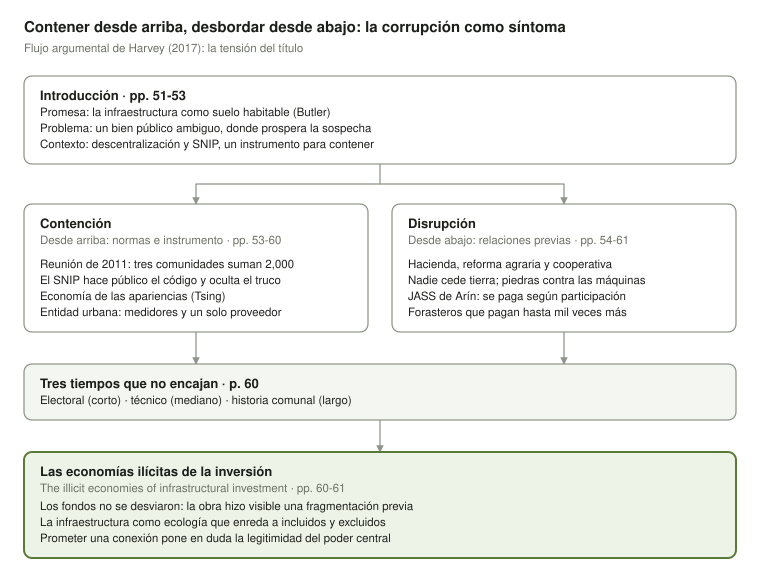

# Harvey (2017) — Containment and disruption: resumen operativo

El capítulo sostiene que la sospecha de corrupción que rodea a las obras públicas nace de cómo esas obras se formulan, se financian y se ejecutan, y que la alimentan los propios instrumentos de transparencia. Lo muestra con un proyecto de agua y desagüe en el valle del Vilcanota, en Cusco.

**Referencia:** Harvey, P. (2017). Containment and disruption: The illicit economies of infrastructural investment. En P. Harvey, C. B. Jensen y A. Morita (Eds.), *Infrastructures and social complexity: A companion* (pp. 51-63). Routledge.

Las afirmaciones van parafraseadas, con la página de la edición impresa para ubicar la oración original.

## Objetivos y estrategia retórica

### Objetivo general

El capítulo explora cómo los proyectos de infraestructura pública alimentan una relación simbiótica entre el miedo a la corrupción y las medidas de transparencia (p. 52). Lo hace etnográficamente, con el intento de instalar un sistema de agua y desagüe en tres comunidades del valle del Vilcanota.

Lo que está en juego es cómo leer la corrupción. Harvey propone dejar de verla como desvío de un flujo y leerla como síntoma de una fragmentación que la obra hace visible (p. 60).

### Objetivos específicos

1. Mostrar la desconexión entre el anhelo de "suelo habitable" y la realidad vivida de los proyectos de infraestructura (pp. 51-52).
2. Explicar cómo la forma de formular proyectos, con una carencia precisa y un resultado calculable, produce un "bien público" ambiguo donde prospera la sospecha (p. 52).
3. Situar la infraestructura en la descentralización peruana: su capacidad de cambiar de escala frente a los instrumentos de control central como el SNIP (pp. 52-53).
4. Mostrar en una escena etnográfica cómo el instrumento de transparencia abre y oscurece a la vez, y cómo se constituye el "público" de una obra pública (pp. 53-56).
5. Mostrar la fuerza disruptiva de las relaciones previas: hacienda, reforma agraria y cooperativa, justo sobre la tierra y el agua (pp. 56-57).
6. Sostener que la racionalización administrativa que trae el proyecto es más radical que las tuberías, porque desarma un modelo comunal que funcionaba (pp. 58-60).
7. Releer la corrupción como efecto de escalas y tiempos en conflicto, y la infraestructura como una ecología que pone en duda la legitimidad del poder central (pp. 60-61).

### Estrategia retórica general

- **De lo global a lo local.** Abre con el sentido común del desarrollo: el valor nace de flujos sin trabas y las "infraestructuras críticas" sostienen la seguridad. Luego baja a su "eco refractado" en Perú, donde la gente vive las carreteras como anhelo (p. 51).
- **Preguntas que fijan el problema.** ¿Qué falta exactamente? ¿Por qué alguien cree que una obra puede salvar divisiones sociales profundas? (p. 51).
- **Una escena como centro.** La reunión de octubre de 2011 se narra con discurso directo, retórica del alcalde y un chiste del público. La autora estuvo presente ("I joined").
- **Composición en anillo.** El chiste del baño abre la etnografía (p. 54) y vuelve en la última frase, ahora leído como amenaza (p. 61).
- **Polifonía de posiciones.** El alcalde habla de voluntad política, el jefe de obras de la norma técnica, el ingeniero residente de procedimientos claros y la gente de desconfianza. Un año después, el ingeniero vuelve en tono confesional.
- **Capas de tiempo.** Usa la historia agraria de Mayer (2009) para mostrar que la obra cae sobre relaciones de décadas.
- **Tesis por inversión.** Contra el sentido común, los fondos no se desviaron, y la transparencia produce sospecha en vez de disiparla (p. 60).
- **Conceptos prestados para nombrar lo observado.** Suelo habitable (Butler), anhelo (Schweizer), público (Warner), Estado mágico (Coronil), economía de las apariencias (Tsing), economías ocultas (Comaroff), temporalidades disyuntivas (Bear).
- **Contraste de modelos.** Compara el modelo comunal de Sanbasur y las JASS con la entidad urbana estandarizada que impone el proyecto.

## Recorrido sección por sección

El capítulo tiene cinco partes. Una introducción sin título plantea el problema; tres secciones etnográficas siguen el proyecto desde su anuncio hasta su impasse; la última relee la corrupción.

| Sección | Págs. | Función en el argumento |
| --- | --- | --- |
| (Introducción sin título) | 51-53 | Promesa de suelo habitable, bien público ambiguo, descentralización y SNIP |
| Calling a new infrastructure into being | 53-56 | La reunión de 2011: el instrumento de transparencia abre y oscurece |
| The disruptive force of prior relations | 56-57 | La historia agraria que la obra supone neutral |
| Political will or technical solution | 57-60 | El impasse y la racionalización administrativa |
| The illicit economies of infrastructural investment | 60-61 | La corrupción como síntoma; la infraestructura como ecología |

### Vocabulario del capítulo

| Término | Qué significa aquí | Pág. |
| --- | --- | --- |
| Suelo habitable (inhabitable ground) | Las condiciones materiales básicas sobre las que se construye una forma de vida (Butler 2014) | 51 |
| Anhelo | Modo de espera sin urgencia, abierto y encarnado, por algo que falta; su fuerza viene de esa falta | 51 |
| SNIP | Sistema Nacional de Inversión Pública: exige costos, beneficios y un relato causal lineal de problema y solución | 53 |
| Reescalamiento | Capacidad de la infraestructura de conectar escalas: volver global lo local y localizar flujos de capital | 53 |
| Economía de las apariencias | Producción de cifras y planes que parecen razonables para que el dinero fluya (Tsing 2000) | 58 |
| JASS | Junta administradora de servicios de saneamiento: el comité local de agua | 58-59 |
| Temporalidades disyuntivas | Ritmos que no coinciden: el electoral, el técnico y el de la historia comunal (Bear 2014) | 60 |
| Ecología | La infraestructura como algo que emplaza personas y capital a la vez que habilita flujos | 61 |

### 1. Introducción sin título (pp. 51-53)

La introducción va de la promesa del desarrollo a la tesis y al instrumento que la etnografía va a seguir, el SNIP.

1. **La promesa del suelo habitable (p. 51).** Crecimiento e inversión en infraestructura se articulan en una idea normativa: el valor nace de flujos sin trabas de personas, productos, información y dinero. Las obras públicas se justifican como bienes públicos en esos términos.
    - Afirmación: las infraestructuras de desarrollo tienen carga moral, porque prometen un futuro mejor. Esa promesa supone que dan "suelo habitable" (Butler 2014).
    - Afirmación: el mismo supuesto explica la ansiedad por las "infraestructuras críticas", que los gobiernos vuelven asunto de seguridad (Collier y Lakoff 2008).
2. **El anhelo (p. 51).** Donde los cimientos prometidos se aplazan sin fin, ese miedo tiene un eco refractado. En Perú la gente expresa su deseo de carreteras como anhelo.
    - Definición: el anhelo es una espera sin urgencia, larga y abierta, por algo palpablemente ausente (Schweizer 2008). Genera una demanda cuya fuerza viene de la falta.
3. **La tesis (pp. 51-52).** ¿Qué falta exactamente? ¿Por qué se espera que una obra resuelva divisiones sociales profundas?
    - Tesis: hay desconexiones fundamentales entre el anhelo de suelo habitable y la realidad de los proyectos. Se manifiestan en la creencia extendida de que las obras están plagadas de corrupción.
    - Tesis: esa creencia tiene raíz en los procedimientos con que las obras se formulan, financian y ejecutan en nombre del bien público.
4. **Un bien público ambiguo (p. 52).** Los proyectos de desarrollo necesitan una carencia precisa y un resultado calculable: un puente contra el aislamiento, un desagüe medido en mortalidad infantil. Pero la solución de ingeniería coincide solo vagamente con los efectos sociales y las expectativas.
    - Afirmación: los estudios de riesgo y de impacto no pueden resolver ese desajuste. Se agrava cuando los inversionistas no tienen interés en el servicio público y los políticos deben suturar la brecha.
    - Afirmación: las expectativas divergentes coinciden un momento en un bien público vago y reaparecen cuando la obra toma forma. Esa ambigüedad es el suelo donde prospera la sospecha.
5. **Objetivo y caso (p. 52).** Harvey se propone explorar la simbiosis entre miedo a la corrupción y medidas de transparencia, y la sensibilidad hacia todo lo que no se ve.
    - Caso: un nuevo sistema de agua y desagüe en el valle del Vilcanota, parte de un estudio más amplio sobre descentralización (el proyecto Experimental States, con Deborah Poole y otros; nota 7).
6. **Descentralización y reescalamiento (pp. 52-53).** La descentralización peruana responde a regionalismos fuertes y a una desigualdad racializada de origen colonial, y también al giro neoliberal que promovieron el Banco Mundial y el BID.
    - Afirmación: las autonomías son parciales y el poder fiscal sigue en el centro. La política se vuelve técnica: el político exitoso conoce las ambigüedades de la ley.
    - Afirmación: las obras pesan tanto porque pueden cambiar de escala. Vuelven global lo local con flujos de dinero e información y anclan el capital en lugares concretos; reúnen intereses divergentes mientras separan y desconectan.
7. **El SNIP como contención (p. 53).** Ese poder de reescalar amenaza una descentralización controlada. El Ministerio de Economía responde con instrumentos como el SNIP, pensado para que la inversión sea transparente y racional y frenar el gasto populista.
    - Afirmación: el SNIP exige costos y beneficios y un relato causal lineal de problema y solución. Estos instrumentos tienen fuerza infraestructural propia: financiarizan los servicios públicos y los preparan para la privatización.

### 2. Calling a new infrastructure into being (pp. 53-56)

La sección narra la reunión en que se anuncia la obra y muestra, en el mismo acto, cómo la transparencia abre un espacio de manipulación.

1. **El anuncio (pp. 53-54).** En octubre de 2011, el alcalde provincial reúne a tres comunidades rurales, Huarán, Arín y Sillacancha. Anuncia un sistema integrado de agua potable y desagüe para cada casa.
    - Evidencia: la obra era parte de un pacto político por sus votos. El alcalde dice que hizo lobby ante el gobierno regional, que consiguió los fondos y que es "un hombre pobre como ellos".
    - Evidencia: alguien del público grita que se acordarán de él cada vez que vayan al baño. Todos ríen.
2. **La norma técnica (p. 54).** El jefe de obras explica que los fondos estaban atados a una norma: el sistema debía servir a un asentamiento urbano de al menos 2,000 habitantes.
    - Evidencia: cumplieron la condición sumando las poblaciones de las tres comunidades, ninguna suficiente por sí sola. "Esta zona ya no es una comunidad, ahora es un área urbana".
3. **El ingeniero residente (p. 54).** Muestra los planos: agua traída desde 5 km, de cuatro fuentes, trabajo local y faenas comunales. Luego toca la propiedad privada: tuberías por terrenos, calles ensanchadas y un lugar para la planta de tratamiento.
    - Evidencia: al público le preocupa menos volverse urbano que si se puede confiar en los ingenieros. El ingeniero lee en voz alta el código SNIP: todo es público, el proyecto fue aprobado en el presupuesto participativo.
4. **Abierto y oscuro a la vez (pp. 54-55).** Las condiciones del SNIP hacen el proyecto transparente y opaco al mismo tiempo. El alcalde trata el SNIP como una valla burocrática que su voluntad política puede sortear con creatividad.
    - Afirmación: la gente no se inquieta; nadie espera que la transparencia sirva a los intereses locales. Como en el Estado venezolano que estudió Coronil (1997), el Estado es un vector de desorganización más que un defensor del bien público.
    - Contraste: el ingeniero recuerda que la voluntad política no basta y que importa la claridad de los procedimientos.
5. **Las sospechas (p. 55).** ¿Se expropiará tierra? ¿De quién? El alcalde dice que no, pero no dice dónde irá la planta.
    - Evidencia: se murmura sobre obras que no siguen el plan, cifras perdidas, papeles sin obra. Preocupa cómo se gasta el dinero, no tanto cómo se lo hace aparecer. El alcalde cierra: "es una obra pública, es para ustedes".
6. **¿Qué tiene de público? (p. 55).** El alcalde convoca a la multitud como un público (Warner 2002), pero la asistencia era obligatoria, con multas: es un público constituido por coerción. Hay aburrimiento y apoyo irónico.
    - Afirmación: el alcalde habla como figura pública que cumple su deber de cuidado y su pacto electoral. El instrumento de transparencia publica los procedimientos y, a la vez, abre un espacio de manipulación (Nuttall y Mbembe 2015): volver urbanas tres comunidades con un solo número, 2,000.
7. **Un terreno común difícil (p. 56).** La obra exige trabajo conjunto para crear un nuevo suelo común. Pero las tres comunidades arrastran décadas de desconfianza, centradas justo en la tierra y el agua que el proyecto supone neutrales.

### 3. The disruptive force of prior relations (pp. 56-57)

La sección reconstruye, con Mayer (2009), la historia que la obra encuentra en el terreno.

1. **La hacienda (p. 56).** Hasta la reforma agraria de 1969, la zona era de la hacienda Huarán, unas 6,000 hectáreas del fondo del valle a las alturas, formada a costa de Arín y Sillacancha.
    - Evidencia: Arín era hostil; la hacienda le negaba el agua. Su gente trabajaba para ella, robaba lo que podía y migraba a La Convención, donde nacía el movimiento por la reforma. Arín encabezó la expropiación. Sillacancha fue más acomodaticia y menos politizada.
2. **La cooperativa (p. 56).** En los setenta, la cooperativa estatal favoreció a Arín y dejó a muchos sin participación. En 1980, al disolverse, Sillacancha pidió partes iguales y Arín reparto según trabajo; ganó Arín (cita larga de Mayer 2009: 67).
3. **El presente (p. 57).** La cooperativa sigue, disminuida, y su tierra es un lugar posible para recursos comunes. Pero entre comunidades, generaciones y dentro de cada comunidad hay acusaciones de corrupción, secreto y resentimiento.
    - Afirmación: por eso un sistema simple de tuberías y bombas involucra enseguida dimensiones de acción pública en conflicto y combinaciones cambiantes de inversión pública y privada.

### 4. Political will or technical solution (pp. 57-60)

Un año después, la obra está trabada. La sección muestra por qué no hay solución técnica y qué cambia de todos modos: la administración.

1. **Un diseño mal informado (p. 57).** Sigue sin acuerdo el lugar de la planta de tratamiento. El ingeniero residente, ansioso, admite que el diseño original se basó en mala información.
    - Evidencia: el plan suponía tierra comunal; quien lo escribió nunca visitó la zona. Las medidas estaban mal: el sitio propuesto tenía un desnivel de unos 30 m, y el ingeniero bromea con una "cascada de desagüe" como atracción turística.
2. **Tiempos distintos (p. 57).** El ingeniero critica a la gente por no pensar en el plazo correcto: ingenieros y planificadores piensan a mediano y largo plazo.
    - Evidencia: los vecinos se niegan a ceder tierra o a reordenar sus calles. Él lo lee como falta de sentido del "bien común".
3. **Viable en papel (pp. 57-58).** El presupuesto era totalmente insuficiente. Demostrar viabilidad en el papel no es hacerla posible.
    - Afirmación: el SNIP no generó más control ni transparencia. Sostuvo un nuevo nicho de mercado: "estudios" y perfiles técnicos que hacen parecer viables los proyectos.
    - Evidencia: no había fondos para conectar viviendas dispersas, así que menos de la mitad de los vecinos tendría desagüe. Pero el sistema dependía de que todos pagaran.
    - Evidencia: nadie ofrece tierra para la planta. Los propietarios atacaron a pedradas a los trabajadores y las máquinas. El alcalde, con plazos electorales, presiona para entregar la obra.
4. **No hay solución técnica (p. 58).** Los documentos del SNIP describían una comunidad que carecía de desagüe, lo deseaba y estaba dispuesta a lograrlo.
    - Tesis: sin esa comunidad, con una carencia difusa y fondos insuficientes, la obra llegó como intrusión y no como anhelo cumplido.
    - Concepto: el logro del alcalde fue hacer fluir el dinero. Su manejo del SNIP activó una "economía de las apariencias" (Tsing 2000): cifras y plan razonables que ocultaban lo inconmensurable de sumar tres comunidades.
5. **El ingeniero atrapado (p. 58).** Queda entre el "carácter" del alcalde, que quiere la obra para su legado, y una comunidad que en la práctica se niega a ser zona urbana.
    - Evidencia: documenta todo para protegerse de acusaciones de corrupción que pueden venir de cualquier lado.
6. **La racionalización administrativa (pp. 58-59).** Conseguir los fondos solo exigía apariencia de coherencia, pero activó un requisito que no se podía esquivar. Como entidad urbana, las tres comunidades debían abandonar sus sistemas propios y operar como una sola unidad estandarizada.
    - Evidencia: la JASS local debía ser reemplazada por un solo proveedor en la Municipalidad de Calca. Todos pasarían a ser equivalentes, con las mismas condiciones y tarifas.
    - Tesis: esa racionalización es un cambio potencialmente más radical que las tuberías.
7. **El modelo Sanbasur (p. 59).** En 1996, tras la guerra, la ONG suiza Sanbasur introdujo un modelo comunal que activaba los comités locales de agua previstos en la ley municipal. Arín logró que el municipio asumiera sus obligaciones a cambio de fondos de la ONG y trabajo comunal.
    - Afirmación: el modelo era radical porque invertía la jerarquía de la descentralización parcial: energía desde abajo, y localidades que no tenían que ser iguales.
    - Evidencia: la JASS de Arín cobraba el agua según la participación comunal y no por consumo medido. Así evitaba la morosidad, y repetía el criterio con que se repartió la tierra tras la reforma: a favor de quienes la trabajaron como siervos.
8. **Medidores contra comunidad (pp. 59-60).** El nuevo esquema vuelve a la incorporación jerárquica que salta a la comunidad. Los medidores reemplazan la base interpersonal del modelo comunal, que se consideraba propensa a la corrupción.
    - Evidencia: en Huarán viven más forasteros, extranjeros y gente de ciudad que compró tierra en la antigua hacienda. Los pagos diferenciados generan allí resentimiento: algunos pagan más de mil veces lo que pagan sus vecinos.

### 5. The illicit economies of infrastructural investment (pp. 60-61)

La última sección relee lo observado: la corrupción no como desvío de fondos sino como síntoma, y la infraestructura como ecología.

1. **Otra fuente de la sospecha (p. 60).** Los Comaroff (1999) describen en el sur de África rumores de corrupción ante las promesas incumplidas de la modernidad.
    - Tesis: en los Andes del sur peruano también hay rumores, pero la amenaza moral de la corrupción la provocan las propias medidas de transparencia, porque son opacas y manipulables.
2. **La corrupción como síntoma (p. 60).** La descentralización neoliberal hace visibles escalas de control y responsabilidad en conflicto. Las tensiones entre nociones del bien público reproducen la sensación de corrupción endémica.
    - Tesis: la corrupción suele nombrar el punto límite de un flujo, el desvío de fondos de su curso lineal. Aquí los fondos no se desviaron: la llegada de la obra hizo evidente una fragmentación previa que las tuberías no podían salvar.
3. **Tres tiempos (p. 60).** Los fondos eran insuficientes, pero nadie sugirió que se los robaran. Hubo acusaciones mutuas, reforzadas por temporalidades disyuntivas (Bear 2014).
    - Afirmación: el plazo corto del alcalde choca con el horizonte medio de la solución técnica y con la historia larga de tensiones comunales.
4. **Conexión sin tuberías (pp. 60-61).** La promesa de la inversión sigue resonando aunque la obra fracase. La descentralización desconecta y reconecta, y desplaza los lugares del riesgo.
    - Tesis: conecten o no las tuberías, agua, casas y usuarios quedan conectados como objetos de administración. Se concentra el poder administrativo central mientras se descentraliza la responsabilidad del servicio; el cambio administrativo ocurre aunque no cambie nada material.
5. **La infraestructura como ecología (p. 61).** La integración tiene efectos inesperados: cumplir o resistir pasa a formar parte de la ecología del sistema.
    - Tesis: ver la infraestructura como una ecología que emplaza personas y capital, además de habilitar flujos, muestra cómo se enredan incluidos y excluidos. Los puntos límite dejan de ser rupturas de un relato lineal de progreso y corrupción.
    - Afirmación: la conciencia de una ecología compartida puede frenar analíticamente las promesas lineales del desarrollo.
6. **Cierre: el chiste como amenaza (p. 61).** Prometer una conexión pone en duda la legitimidad del poder central.
    - Tesis final: el chiste del baño es más amenaza que elogio. Cada vez que falte el agua, la gente recordará que no cumpliste, que deshiciste su autonomía, y te hará responsable.

Nota de lectura: el título nombra la tensión de todo el capítulo. La contención viene de arriba (el SNIP, la norma de 2,000, la entidad urbana); la disrupción, de las relaciones previas y de la gente que no cede.

## Flujo argumental completo

El argumento sigue la tensión del título. Desde arriba, normas e instrumentos intentan contener la obra; desde abajo, las relaciones previas la desbordan. Ambos lados chocan en tiempos que no encajan, y de ahí sale la relectura de la corrupción.

El mismo esquema, en texto:

- **Introducción (pp. 51-53).** Promesa: la infraestructura como suelo habitable (Butler). Problema: un bien público ambiguo, donde prospera la sospecha. Contexto: descentralización y SNIP, un instrumento para contener.
    - **Contención, desde arriba (pp. 53-60).** Reunión de 2011: tres comunidades suman 2,000. El SNIP hace público el código y oculta el truco. Economía de las apariencias (Tsing). Entidad urbana: medidores y un solo proveedor.
    - **Disrupción, desde abajo (pp. 54-61).** Hacienda, reforma agraria y cooperativa. Nadie cede tierra; piedras contra las máquinas. JASS de Arín: se paga según participación. Forasteros que pagan hasta mil veces más.
- **Tres tiempos que no encajan (p. 60).** Electoral (corto), técnico (mediano), historia comunal (largo).
- **Las economías ilícitas de la inversión (pp. 60-61).** Los fondos no se desviaron: la obra hizo visible una fragmentación previa. La infraestructura como ecología que enreda a incluidos y excluidos. Prometer una conexión pone en duda la legitimidad del poder central.

Las dos columnas agrupan episodios de las secciones 2 a 4 según de qué lado están; esa agrupación es de este resumen, no de la autora.

## Afirmaciones centrales y su apoyo

De las 15 afirmaciones centrales, casi todas se apoyan en la etnografía de un solo caso. Los conceptos ajenos sirven para nombrar lo observado.

| # | Afirmación (paráfrasis) | Tipo | Apoyo en el texto | Pág. |
| --- | --- | --- | --- | --- |
| 1 | Las infraestructuras de desarrollo prometen "suelo habitable" y por eso cargan un valor moral | Tesis conceptual | Butler (2014) | 51 |
| 2 | En Perú la infraestructura se desea como anhelo: una espera larga cuya fuerza viene de la falta | Interpretación | Schweizer (2008); trabajo previo sobre carreteras (Harvey y Knox) | 51 |
| 3 | La sospecha de corrupción nace de cómo se formulan, financian y ejecutan las obras | Tesis | Caso del Vilcanota | 51-52 |
| 4 | Formular una obra exige una carencia precisa, pero la solución técnica coincide mal con lo que la gente espera, y eso vuelve ambiguo el bien público | Tesis | Ejemplos de puentes, represas y desagües | 52 |
| 5 | Las obras importan en la descentralización porque cambian de escala, y eso amenaza el control central | Tesis | Descentralización peruana | 52-53 |
| 6 | El SNIP tiene fuerza infraestructural propia: financiariza los servicios y los prepara para la privatización | Tesis | Análisis del instrumento | 53 |
| 7 | El instrumento de transparencia abre y oscurece a la vez: tres comunidades se vuelven "urbanas" sumando 2,000 habitantes | Empírica | Reunión de octubre de 2011 | 54-55 |
| 8 | El público de una obra pública se constituye por coerción | Interpretación | Asistencia con multa; Warner (2002) | 55 |
| 9 | La obra cae sobre décadas de conflicto justo por la tierra y el agua que supone neutrales | Empírica | Historia de la hacienda y la cooperativa (Mayer 2009) | 56-57 |
| 10 | El SNIP no dio control ni transparencia: creó un mercado de estudios que hacen parecer viables los proyectos | Empírica / interpretación | Testimonio del ingeniero; presupuesto insuficiente | 57-58 |
| 11 | No había solución técnica: la obra fue una intrusión, no un anhelo cumplido | Tesis del caso | Comunidad inexistente en los papeles; tierra negada; pedradas | 58 |
| 12 | El alcalde hizo fluir el dinero con una economía de las apariencias | Interpretación | Tsing (2000); agregación de las tres comunidades | 58 |
| 13 | La racionalización administrativa es más radical que las tuberías y desarma el modelo comunal | Tesis | Reemplazo de la JASS; medidores; caso Sanbasur | 58-60 |
| 14 | La corrupción no fue desvío de fondos: la obra hizo visible una fragmentación previa | Tesis central | Ningún robo sugerido; temporalidades disyuntivas (Bear 2014) | 60 |
| 15 | La infraestructura es una ecología que enreda a incluidos y excluidos y pone en duda la legitimidad central | Tesis final | Lectura del chiste del baño como amenaza | 61 |
