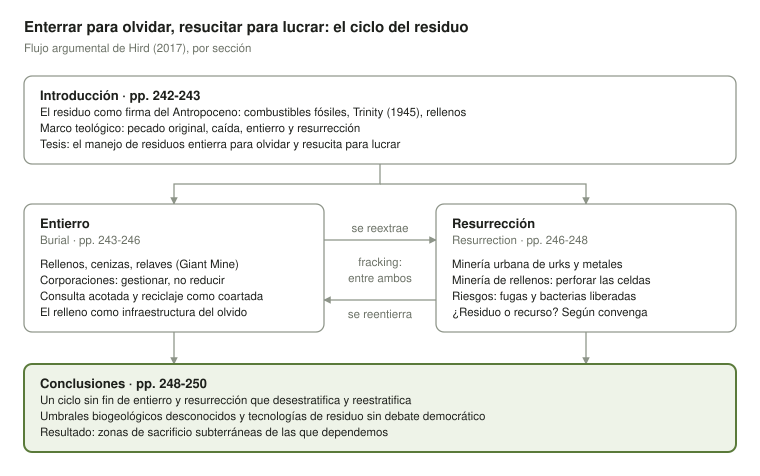

# Hird (2017) — Burial and resurrection in the Anthropocene: resumen operativo

El capítulo sostiene que el residuo es la firma del Antropoceno y que el capitalismo neoliberal lo maneja con un doble gesto: lo entierra para olvidarlo y ahora lo resucita para lucrar. Ese ciclo remueve los estratos de la tierra con consecuencias biológicas y geológicas que no conocemos ni controlamos.

**Referencia:** Hird, M. J. (2017). Burial and resurrection in the Anthropocene: Infrastructures of waste. En P. Harvey, C. B. Jensen y A. Morita (Eds.), *Infrastructures and social complexity: A companion* (pp. 242-252). Routledge.

Las afirmaciones van parafraseadas, con la página de la edición impresa para ubicar la oración original.

## Objetivos y estrategia retórica

### Objetivo general

El capítulo examina el residuo como una forma de entierro capitalista y neoliberal y, más recientemente, de resurrección (p. 243). Hird sostiene que hay a la vez una negación de las secuelas del consumo y un renacer esperanzado, pero ingenuo, de lo enterrado convertido en ganancia.

Lo que está en juego es pensar la infraestructura del residuo a escala geológica. Rellenos, minas y redes urbanas rehacen estratos, y lo hacen sin debate público (pp. 249-250).

### Objetivos específicos

1. Mostrar que el residuo es la firma del Antropoceno, a partir del debate sobre cuándo empieza la época (pp. 242-243).
2. Leer el Antropoceno con el léxico judeocristiano: pecado original, caída, entierro y resurrección (pp. 242-243).
3. Describir las infraestructuras del entierro: botaderos, rellenos, incineradoras, relaves mineros, repositorios nucleares y el Ártico canadiense (p. 243).
4. Mostrar el manejo de residuos como gobierno corporativo neoliberal: gestionar en vez de reducir, consulta acotada y responsabilización individual (pp. 243-245).
5. Sostener que el relleno es una infraestructura de la memoria, o sea, del olvido (pp. 245-246).
6. Describir la resurrección: minería urbana, minería de rellenos y fracking, con sus riesgos ontológicos y biológicos (pp. 246-248).
7. Concluir que el ciclo de entierro y resurrección desestratifica y reestratifica la tierra, y que sus tecnologías están fuera del debate democrático (pp. 248-250).

### Estrategia retórica general

- **Un marco teológico.** El par entierro y resurrección organiza el título y las secciones. Se suman el pecado original, la caída del Edén, "nacer de nuevo" y, al final, Frankenstein. El léxico cristiano se usa en clave crítica.
- **Un comienzo de impacto.** Abre con la prueba Trinity de 1945, el nombre tomado de un soneto de Donne y la cita de Oppenheimer del Bhagavad Gita.
- **Estructura en espejo.** "Burial" y "Resurrection" se responden. El fracking queda "en algún lugar entre" ambos (p. 248).
- **Acumulación de datos.** Cifras de minería, toneladas de arsénico, la inversión de Bill Gates, la vida útil de un relleno, el material que se mueve cada año, los biocidas aprobados. El peso de los números sostiene la denuncia.
- **Cruce de disciplinas.** Estratigrafía, microbiología, economía política y estudios sobre públicos y consulta. Hird cita su propia investigación sobre residuos en Canadá.
- **Autocrítica del campo.** Señala que la investigación sobre residuos domésticos reproduce, sin querer, la desviación de la atención que logra la industria (p. 245).
- **Interlocutores recurrentes.** Gordillo (*Rubble*) y Easterling (*Extrastatecraft*) vuelven en cada sección. Aparecen también Elden, van Wyck, Derrida y Cooper.
- **Contraste con el cambio climático.** En el clima las tecnologías se discuten; en los residuos ya están políticamente sedimentadas (p. 249).
- **Cierre normativo.** Termina con una imagen: hemos creado zonas de sacrificio subterráneas de las que dependemos (p. 250).

## Recorrido sección por sección

El capítulo tiene cuatro partes. La introducción fija la tesis; "Burial" y "Resurrection" se responden como un díptico; las conclusiones ven en ese par un ciclo que remueve la tierra.

| Sección | Págs. | Función en el argumento |
| --- | --- | --- |
| Introduction | 242-243 | El residuo como firma del Antropoceno; el marco teológico |
| Burial | 243-246 | Enterrar para olvidar: infraestructuras, corporaciones y memoria |
| Resurrection | 246-248 | Resucitar para lucrar: minería urbana, de rellenos y fracking |
| Conclusions | 248-250 | Un ciclo que desestratifica y reestratifica, sin debate democrático |

### Vocabulario del capítulo

| Término | Qué significa aquí | Pág. |
| --- | --- | --- |
| Antropoceno | Época en que la actividad humana se cruza, por su magnitud, con las fuerzas geofísicas del planeta | 242 |
| Entierro (burial) | Manejo del residuo que lo saca de la vista y de la memoria para poder seguir consumiendo | 243, 245-246 |
| Resurrección | Excavar rellenos y ciudades para devolver lo enterrado a la superficie como valor capitalista | 246 |
| Infraestructura de la memoria | El relleno como lugar de olvido, sostenido por leyes, reglamentos, modelos de riesgo e ingeniería | 245-246 |
| Responsabilización individual | Hacer que las personas carguen con el residuo doméstico mediante incentivos y sanciones | 245 |
| Urks | Restos de infraestructuras urbanas abandonadas, como cables y tuberías bajo tierra | 246-247 |
| Stocks hibernantes | Metales dentro del entorno construido que la industria evalúa recuperar | 247 |
| Desestratificación y reestratificación | Remover y volver a apilar materiales de la tierra en capas que no son las originales | 248-249 |

### 1. Introduction (pp. 242-243)

La introducción parte del debate sobre el inicio del Antropoceno y llega a la tesis por medio de un marco teológico.

1. **Un concepto en auge (p. 242).** Desde la propuesta de Crutzen y Stoermer (2000), el Antropoceno se volvió una industria en crecimiento: época, símbolo, llamado a la acción, giro intelectual. Señala el fin del Holoceno.
2. **¿Dónde poner el clavo? (p. 242).** Para unos empieza con la Revolución Industrial y la quema de combustibles fósiles; el texto la sitúa a fines del siglo XVII. Para otros, unos 8,000 años antes, con el desmonte neolítico; para otros, con el dominio del fuego.
    - Evidencia: Crutzen cambió de opinión y ubica el inicio el 16 de julio de 1945, con la detonación Trinity y su residuo radiactivo. El grupo de trabajo de la Subcomisión de Estratigrafía del Cuaternario coincidió (Monastersky 2015).
3. **El pecado original (pp. 242-243).** El nombre de la prueba se atribuye a Oppenheimer, a partir de un soneto devocional de John Donne. Oppenheimer citó también el Bhagavad Gita en un documental de 1965.
    - Afirmación: marcado por el legado cristiano, el Antropoceno puede ser la marca material y simbólica del pecado original de la especie. La sed de conocimiento se volvió una disociación ilustrada entre humanidad y naturaleza, que hizo posible la Gran Aceleración.
    - Afirmación: la caída trajo la mortalidad; el Antropoceno contempla nuestra extinción.
4. **La tesis (p. 243).** Los combustibles fósiles, que son "necro-residuo" de organismos enterrados; las detonaciones nucleares; los botaderos y rellenos que archivan la extracción, el consumo y el descarte. Con todo eso se puede sostener que el residuo es la firma del Antropoceno.
    - Tesis: el capítulo trata el residuo como entierro capitalista y neoliberal y, más recientemente, como resurrección.
    - Tesis: hay una negación de las secuelas del consumo, porque el manejo de residuos nos hace olvidar para volver a pecar. Y hay un renacer esperanzado, pero ingenuo, cuando lo enterrado resucita como ganancia.

### 2. Burial (pp. 243-246)

La sección describe las infraestructuras del entierro, quién las controla y cómo producen olvido.

1. **Botaderos, rellenos, incineradoras (p. 243).** En muchas regiones los basurales abiertos sobreviven a la modernidad y sostienen el "planeta de ciudades miseria" de Davis (2007). En los países llamados desarrollados los reemplazan rellenos e incineradoras.
    - Afirmación: las incineradoras se presentan como más limpias, pero dejan cenizas que terminan enterradas en el relleno.
2. **Relaves y repositorios (p. 243).** Las mineras consideran residuo entre el 95 % y el 99.99 % de lo que extraen; lo dejan en el paisaje o lo vuelven a enterrar.
    - Evidencia: en la Giant Mine de Canadá, unas 237,000 toneladas de polvo de trióxido de arsénico se volverán a enterrar congeladas a perpetuidad, con la esperanza de que una generación futura resuelva el problema (Hird 2015).
    - Afirmación: es la misma lógica de los repositorios geológicos profundos para el residuo nuclear, que lo guardan "temporalmente a perpetuidad".
3. **El Ártico (p. 243).** En el Ártico canadiense el residuo militar, industrial y municipal sigue en el paisaje, mezclado con los inuit, la flora y la fauna.
    - Afirmación: allí el residuo es síntoma de un legado colonial violento y de la explotación de recursos en curso (Hird y Zahara; Scott 2008).
4. **De carreteros a multinacionales (pp. 243-244).** Antes de la Revolución Industrial, operadores individuales se llevaban los desechos. Eso introdujo un gobierno del residuo basado en aislarlo de la vida comunitaria.
    - Afirmación: con más volumen llegaron grandes empresas y luego multinacionales, que definieron el residuo como algo que se gestiona, no como algo que se reduce.
    - Evidencia: en 2001 Bill Gates se volvió el mayor accionista de Republic Services, dueña de rellenos en Estados Unidos. Mientras las ganancias de Microsoft caían, su negocio de residuos creció más del 45 % (Bélanger 2007).
5. **Una consulta acotada (p. 244).** Corporaciones y gobiernos locales piden al público que acepte evaluaciones limitadas de antemano a respuestas de "final de tubo", o sea, a la disposición. Luego se acotan los sitios, las tecnologías, los eventos y los plazos.
    - Afirmación: con ingenieros propios, redes en el gobierno y equipos de relaciones públicas, estas empresas manejan la discusión pública. La gobernanza neoliberal pone la consulta y los estudios de factibilidad en manos de la industria.
    - Apoyo: una cita larga de Easterling (2014) sobre la Organización Internacional de Normalización sirve para describir a la corporación de residuos: busca impacto universal y consenso sin diálogo político.
6. **Una infraestructura del capital (pp. 244-245).** El residuo viaja por una infraestructura de transporte entre regiones y continentes. Los rellenos son infraestructuras complejas de geomembranas, captación de lixiviados y gases, monitoreo y cierre.
    - Afirmación: esta infraestructura es tan económica, política, cultural y simbólica como material. Funciona con mercado, privatización y menos control estatal, y responsabiliza a las personas por el residuo doméstico con incentivos y sanciones (Hird et al. 2014).
7. **Soluciones que no lo son (p. 245).** Las soluciones son de corto plazo y no frenan el consumo. Reprocesar gasta energía fósil; reciclar libera residuos peligrosos y da productos de menor calidad.
    - Evidencia: el secreto sucio del reciclaje es que, según los mercados, lo que la gente cree desviado termina en el relleno o la incineradora (Hird et al. 2014). Hay evidencia de que se produce más residuo cuando hay reciclaje (Lougheed, Hird y Rowe 2016).
    - Tesis: el gran logro de industria y gobierno es desviar la atención del residuo industrial y militar, mucho mayor. Quienes investigan el residuo doméstico, más accesible, reproducen sin querer esa desviación.
8. **Ingeniería de la quietud (p. 245).** El relleno se diseña para que todo se quede quieto, para asegurar el volumen (Elden 2013). Los mejores contienen el residuo unos cien años, menos que un suspiro en tiempo geológico.
    - Afirmación: las incertidumbres se traducen en riesgos calculables, para poder asignar y acotar culpas cuando el relleno se filtra, explota o arde (Hird 2014).
9. **Infraestructura del olvido (pp. 245-246).** Los rellenos son lugares de olvido: el entierro saca el residuo de la vista y de la mente. Ese olvido lo hacen posible leyes, reglamentos, modelos de riesgo, aceptación comunitaria e ingeniería.
    - Afirmación: la industria complace nuestro deseo de borrar esos pecados de la memoria. Recordar el residuo sería dar testimonio de lo que no queremos recordar (van Wyck 2013).
    - Evidencia: parte del cierre de un relleno es borrarlo de la memoria: se cubre con pasto, parques, viviendas o pistas de esquí.
    - Afirmación: pero el residuo tiene una vida póstuma propia. Cuando vuelve a la vista, es sedimentación material de la destrucción (Gordillo 2014).

### 3. Resurrection (pp. 246-248)

La sección muestra el giro reciente: lo enterrado vuelve a la superficie como mercancía, con riesgos que nadie controla.

1. **Un renacer empresarial (p. 246).** Si el relleno intenta borrar los pecados y su memoria, la geoingeniería empresarial reciente habla de renacer. Excavar rellenos y ciudades devuelve lo enterrado a la superficie convertido en valor.
    - Afirmación: estas empresas se suman a la minería a gran escala y a la fractura hidráulica.
2. **Lo digital es material (p. 246).** Las ciudades pensadas como infraestructuras digitales dependen de cables, tuberías, metales y combustibles fósiles.
    - Apoyo: Easterling (2014) ve la infraestructura como el punto de contacto entre todos, las reglas del espacio cotidiano. Las industrias privadas que la construyeron moldearon leyes y valores defendidos con armas.
3. **Los urks (pp. 246-247).** Cuando una tecnología se rompe y no se repara, la infraestructura se vuelve residuo. Los urks, restos de infraestructura urbana, se suman a rellenos y repositorios nucleares, y como ya están bajo tierra se olvidan más fácil.
    - Apoyo: si el fantasma es el retorno permanente de lo ausente (Derrida 1994), cabe preguntar si resucitar urks da testimonio de un pasado vivo o de un futuro vivo (Gordillo 2014).
    - Afirmación: la literatura atiende lo sociotécnico de la infraestructura y casi nunca sus residuos, emisiones y contaminación (Monstadt 2009). Hay una jerarquía: lo que no puede resucitar es materia inferior.
4. **Minería urbana (p. 247).** Usamos casi todos los metales de la tabla periódica (UNEP 2010), y las industrias evalúan extraer níquel, cobre, hierro y aluminio de los "stocks hibernantes".
    - Evidencia: en el entorno construido hay tanto o más hierro y cobre que en los yacimientos conocidos (Johansson 2013). Tuberías y cables son cerca de un cuarto del peso de la infraestructura de una ciudad y a veces contienen tanto metal como una mina activa (Wallsten 2014).
5. **Difícil de recuperar (p. 247).** Cables y tuberías se superponen por etapas de planificación; los registros son malos, con archivos borrados y mapas abandonados. A menudo lo abandonado aparece recién al reparar lo que funciona.
    - Afirmación: como la minería primaria rinde cada vez menos, el interés por los urks muestra el alcance vertical y horizontal del capitalismo. La destrucción se redefine como innovación (Gordillo 2014).
6. **¿Residuo o recurso? (p. 247).** Si los urks fueran residuo, habría que retirarlos y enterrarlos en rellenos, una remediación casi imposible que pondría en riesgo las capas superiores.
    - Afirmación: por eso se los define como otra cosa, suelo contaminado o recurso, y se evita la obligación de remediar. Es una definición de conveniencia, siempre provisional: pueden filtrar PCB, CFC o plomo, y extraerlos puede provocar la fuga.
    - Afirmación: gran parte de lo que salga con los metales volverá a ser residuo y a enterrarse.
7. **Minería de rellenos (pp. 247-248).** La mayor parte de lo que se recoge para reciclar termina en rellenos (Kim y Owens 2010; UN-HABITAT 2010), y los rellenos están llenos de metales (Johansson 2013).
    - Evidencia: hay estudios exploratorios de "posminería" con perforaciones verticales que cruzan las celdas. Es un trabajo precario: rompe las geomembranas, mezcla materiales tóxicos y mete oxígeno, lo que cambia el metabolismo bacteriano del relleno.
    - Tesis: si enterrar ya es reapilar materiales extraídos, minar el relleno es una reextracción, otra desestratificación de producciones del tiempo planetario profundo (Clark y Hird 2014).
8. **El fracking, entre ambos (p. 248).** Entre entierro y resurrección está la fractura hidráulica. Aumentaría los 57,000 millones de toneladas de material que ya movemos cada año del subsuelo a la superficie (Douglas y Lawson 2000).
    - Evidencia: desentierra miles de millones de bacterias extremófilas. Para destapar los pozos, las empresas inyectan millones de litros de biocidas; la EPA aprobó más de 28 (Kahrilas et al. 2015).
    - Afirmación: no conocemos los efectos de esas filtraciones ni de la interacción entre extremófilas y los ecosistemas bacterianos de los que dependemos. Como aprendió el doctor Frankenstein, resucitar puede revivir o crear más de lo que se quiere.

### 4. Conclusions (pp. 248-250)

Las conclusiones convierten el díptico en ciclo y le suman una crítica política.

1. **Un ciclo hecho posible (pp. 248-249).** En algunos casos hay más metales bajo las ciudades que en el suelo, y eso alienta la reextracción. Extracción, descarte, reextracción y nuevo descarte dependen de aparatos políticos, económicos y culturales de ganancia, sostenibilidad y soberanía.
    - Afirmación: el ciclo también pasa por la geosfera, la pedosfera y el microcosmos, que ponen límites materiales y abren posibilidades especulativas (Labban 2014).
2. **Los límites de la infraestructura (p. 249).** La estabilidad del Holoceno hizo posible la extracción y la infraestructura de la sociedad global.
    - Afirmación: el Antropoceno marca sus límites: los recursos se agotan, el permafrost que se derrite daña el almacenamiento de relaves y la extracción libera microcosmos nuevos.
3. **Entierro y resurrección sin fin (p. 249).** Los cientos de miles de botaderos y rellenos del mundo son una infraestructura crítica que casi nadie reconoce, donde se cruzan relaciones sociales y materiales a escala global.
    - Tesis: la resurrección del residuo como recurso pone en marcha procesos inciertos de desestratificación y reestratificación. El residuo muestra la interacción entre el tiempo geológico profundo y una actividad humana breve pero significativa.
    - Afirmación: el residuo es la secuela y el exceso del "capitalismo terminal". La fe en la geoingeniería lo imagina inerte y controlable desde el presente (Gordillo 2014), cuando es soporte de la vida urbana y parte de la vida química y biológica (nota 1).
4. **Estratos con otros ingredientes (p. 249).** Recomponemos estratos, pero no con sus ingredientes originales. Usamos minas abandonadas como rellenos y minamos rellenos, y así distintas formas de residuo se mezclan de modo impredecible.
    - Afirmación: a diferencia del clima, que se modela, no conocemos los umbrales biogeológicos del residuo: ni de volumen, ni de lo que las bacterias producen, ni de lo que harán deslizamientos, terremotos, inundaciones o el deshielo con los relaves tóxicos.
5. **Una sedimentación política (pp. 249-250).** En la mitigación del cambio climático las tecnologías todavía se discuten. Las del residuo ya están políticamente sedimentadas: el residuo recibe poca atención pública y poco diálogo democrático.
    - Apoyo: en el circuito de producción, consumo y residuo no se apela a un ciudadano que no sea también consumidor (Easterling 2014). Las tecnologías fomentan más residuo y pueden ser tan impredecibles como el problema que dicen resolver (Cooper 2010).
6. **Zonas de sacrificio (p. 250).** El metabolismo del Antropoceno que produce residuo es una destrucción creativa que se nota, pero se neutraliza afectivamente: por negación, mitigación, indiferencia, olvido, empresa e innovación (Gordillo 2014; Stoler 2009).
    - Tesis final: al intentar enterrar nuestros pecados y renacer en un ambiente sostenible, creamos enormes zonas de sacrificio subterráneas. Sabemos poco de sus conexiones con los ecosistemas, las controlamos menos y, aun así, dependemos de ellas.

Nota de lectura: el marco teológico tiene un doble filo. Da fuerza retórica a la denuncia, pero también moraliza el problema como "pecado" de la especie. El cuerpo del capítulo, en cambio, culpa a actores precisos: corporaciones, gobiernos y la industria minera y militar.

## Flujo argumental completo

El argumento arma un díptico y lo convierte en ciclo. La introducción fija el residuo como firma del Antropoceno; el entierro y la resurrección se alimentan uno al otro; las conclusiones muestran que ese ciclo rehace los estratos sin control ni debate.

El mismo esquema, en texto:

- **Introducción (pp. 242-243).** El residuo como firma del Antropoceno: combustibles fósiles, Trinity (1945), rellenos. Marco teológico: pecado original, caída, entierro y resurrección. Tesis: el manejo de residuos entierra para olvidar y resucita para lucrar.
    - **Entierro (pp. 243-246).** Rellenos, cenizas, relaves (Giant Mine). Corporaciones: gestionar, no reducir. Consulta acotada y reciclaje como coartada. El relleno como infraestructura del olvido.
    - **Resurrección (pp. 246-248).** Minería urbana de urks y metales. Minería de rellenos: perforar las celdas. Riesgos: fugas y bacterias liberadas. ¿Residuo o recurso? Según convenga.
    - Lo enterrado se reextrae y lo reextraído se reentierra; el fracking queda entre ambos.
- **Conclusiones (pp. 248-250).** Un ciclo sin fin de entierro y resurrección que desestratifica y reestratifica. Umbrales biogeológicos desconocidos y tecnologías de residuo sin debate democrático. Resultado: zonas de sacrificio subterráneas de las que dependemos.

## Afirmaciones centrales y su apoyo

De las 15 afirmaciones centrales, las empíricas se apoyan en cifras de la industria y en estudios de terceros; las tesis, en el marco teológico y en Gordillo y Easterling.

| # | Afirmación (paráfrasis) | Tipo | Apoyo en el texto | Pág. |
| --- | --- | --- | --- | --- |
| 1 | El inicio del Antropoceno se discute, y Crutzen y el grupo de trabajo lo ubican en la prueba Trinity de 1945 | Empírica | Monastersky (2015) | 242 |
| 2 | El Antropoceno puede leerse como marca del pecado original: la separación ilustrada entre humanidad y naturaleza | Interpretación | Donne, Oppenheimer, Bhagavad Gita | 242-243 |
| 3 | El residuo es la firma del Antropoceno | Tesis | Combustibles fósiles, detonaciones nucleares, rellenos | 243 |
| 4 | El manejo de residuos entierra para olvidar y ahora resucita para lucrar | Tesis central | Estructura del capítulo | 243 |
| 5 | Enterrar "a perpetuidad" posterga el problema a generaciones futuras | Empírica | Giant Mine: unas 237,000 t de trióxido de arsénico congeladas (Hird 2015) | 243 |
| 6 | En el Ártico canadiense el residuo es síntoma de un legado colonial | Interpretación | Hird y Zahara; Scott (2008) | 243 |
| 7 | Las corporaciones definieron el residuo como algo que se gestiona y no que se reduce | Tesis | Historia del sector; Bill Gates y Republic Services (Bélanger 2007) | 243-244 |
| 8 | La gobernanza neoliberal acota la consulta pública y la pone en manos de la industria | Tesis | Estudios sobre consulta; Easterling (2014) | 244 |
| 9 | El reciclaje no frena el consumo y a veces lo aumenta | Empírica | Hird et al. (2014); Lougheed, Hird y Rowe (2016) | 245 |
| 10 | Industria y gobierno desvían la atención del residuo industrial y militar, y la investigación lo reproduce | Tesis | Accesibilidad de los datos domésticos | 245 |
| 11 | El relleno es una infraestructura del olvido | Tesis | Cierre con parques, viviendas o pistas; van Wyck (2013); Gordillo (2014) | 245-246 |
| 12 | El entorno construido guarda tanto metal como los yacimientos, y eso impulsa la minería urbana | Empírica | Johansson (2013); Wallsten (2014); UNEP (2010) | 247 |
| 13 | Que los urks sean "residuo" o "recurso" es una definición de conveniencia | Interpretación | Wallsten (2014) | 247 |
| 14 | Minar rellenos y hacer fracking desestratifica la tierra y libera bacterias con efectos desconocidos | Empírica / especulativa | Clark y Hird (2014); 57,000 millones de t al año; más de 28 biocidas aprobados | 247-248 |
| 15 | Las tecnologías del residuo están políticamente sedimentadas y crean zonas de sacrificio de las que dependemos | Tesis final | Contraste con el clima; Easterling (2014); Cooper (2010) | 249-250 |
