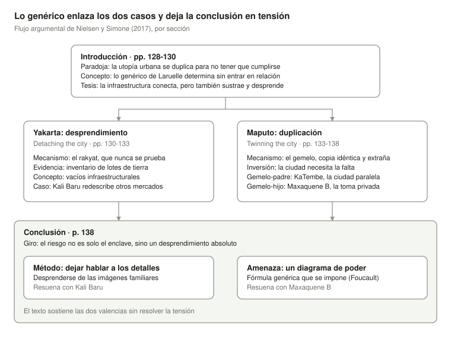

# Nielsen y Simone (2017) — The generic city: resumen operativo

El capítulo sostiene que las ciudades de África y Asia se transforman tanto por desprendimiento y duplicación como por conexión. Para mostrarlo aplica el concepto de lo genérico de François Laruelle a dos casos: Yakarta y Maputo.

**Referencia:** Nielsen, M. y Simone, A. (2017). The generic city: Examples from Jakarta, Indonesia, and Maputo, Mozambique. En P. Harvey, C. B. Jensen y A. Morita (Eds.), *Infrastructures and social complexity: A companion* (pp. 128-140). Routledge.

Las afirmaciones van parafraseadas, con la página de la edición impresa para ubicar la oración original.

## Objetivos y estrategia retórica

### Objetivo general

El capítulo rastrea cómo opera lo genérico en dos ciudades: cómo ciertas configuraciones infraestructurales gestan la ciudad desde dentro sin someterla del todo (pp. 128, 130). En Maputo lo hacen por duplicación ("twinning"); en Yakarta, por desprendimiento ("detaching") y por la referencia a un "pueblo" (rakyat).

Lo que está en juego es una redefinición de la infraestructura. No sería solo lo que combina y conecta, sino también lo que sustrae y desprende (p. 130).

### Objetivos específicos

1. Mostrar que las "ciudades paralelas" proyectadas, aunque no estén construidas, ya reconfiguran la ciudad existente (pp. 128-129, 135).
2. Sostener que la toma discreta de barrios céntricos por inversionistas privados ocurre como "gemelo" de la infraestructura vistosa de la ciudad paralela (pp. 129, 137).
3. Mostrar que en Yakarta el rakyat funciona como infraestructura genérica: nunca se prueba empíricamente y aun así formatea cómo se usa y se narra la tierra (pp. 129, 131).
4. Leer el desprendimiento como recurso analítico y no solo como exclusión o segregación (p. 130).
5. Discutir con la tesis de la urbanización planetaria de Brenner y Schmid: los detalles urbanos podrían actuar al margen de los procesos globales (pp. 132, 134).
6. Desplazar el diagnóstico crítico del enclave (Davis, Harvey) hacia otro problema: un desprendimiento absoluto que funciona como diagrama de poder (p. 138).

### Estrategia retórica general

- **Importación filosófica.** El capítulo parte de un concepto y no de los datos: lo genérico de la no-filosofía de Laruelle, leído a través de Galloway y Srnicek. La etnografía le da cuerpo al concepto. De ahí viene el vocabulario técnico: clon, "limited universalism", "weak a priori".
- **Yuxtaposición, no comparación.** Los autores llaman a los casos "dominios dispares" (p. 130). Cada uno ilustra una modalidad distinta de lo genérico y no se miden con las mismas variables.
- **Metáforas de parentesco y biología.** Gemelos, "fetus-in-fetu", gestación, clon, gemelo-padre y gemelo-hijo, obligaciones familiares. Estas imágenes organizan el caso de Maputo y reaparecen en la conclusión.
- **La paradoja como motor.** Una utopía que no puede cumplirse, una copia idéntica que es extraña a su original, una ciudad "menos que dos, más que uno" (p. 135), una identidad sin síntesis (p. 137).
- **Preguntas retóricas y modo especulativo.** Muchas tesis llegan como preguntas del tipo "¿no podría ser que...?", y los autores declaran que especulan (p. 137). Las afirmaciones fuertes quedan atenuadas.
- **El inventario como prueba.** La enumeración de usos de la tierra en Yakarta ("some land...", pp. 131-132) actúa el argumento. Exhibe detalles que ninguna rúbrica general alcanza a resumir.
- **"Sí, pero".** Conceden a sus interlocutores (Brenner y Schmid tienen razón, Harvey también) y luego abren una posibilidad lateral. No refutan: desplazan.
- **Evidencia ilustrativa.** La etnografía es breve. Pesan cifras sueltas, fragmentos de entrevistas y el discurso de planificadores municipales; no hay datos sistemáticos.

## Recorrido sección por sección

El capítulo tiene cuatro partes. La introducción plantea el concepto, los dos casos lo encarnan en modalidades opuestas y la conclusión da vuelta al diagnóstico crítico de la ciudad fortificada.

| Sección | Págs. | Función en el argumento | Mecanismo de lo genérico |
| --- | --- | --- | --- |
| Introduction | 128-130 | Paradoja de la utopía urbana, presentación de los casos, definición de lo genérico | Sustracción, "limited universalism" |
| Detaching the city (Yakarta) | 130-133 | Muestra que el desprendimiento es productivo | Rakyat, "infrastructural voids" |
| Twinning the city (Maputo) | 133-138 | Desarrolla el mecanismo del gemelo | Clon, gemelo-padre y gemelo-hijo |
| Conclusion | 138 | Invierte el diagnóstico del enclave y propone un método | Diagrama de poder, "dejar hablar a los detalles" |

Ojo con el orden: la introducción anuncia Maputo primero, pero el cuerpo empieza por Yakarta.

### Vocabulario del capítulo

| Término | Qué significa aquí | Pág. |
| --- | --- | --- |
| Lo genérico (Laruelle) | A la vez "cualquier cosa" y "nada más que lo que uno es". Determina sin entrar en relación: indiferente a lo que determina e inmanente a ello | 129-130, 134 |
| Limited universalism / weak a priori | Fuerza que interviene y transforma un dominio sin someterlo del todo ni imponerse como trascendente | 130, 134, 137-138 |
| Sustracción / desprendimiento | Operación infraestructural que convierte un término de definición máxima en uno de definición mínima | 130, nota 2 |
| Twinning / clon | Copia idéntica que resulta extraña a su original; identidad sin síntesis | 128-129, 134, 137 |
| Rakyat | "El pueblo" en Indonesia: no es un concepto sino un formateo del sentimiento igualitario | 129, 131 |
| Infraestructura | Formateo de la estabilidad que coagula relaciones líquidas y reúne sentimiento, autorización, finanzas y trabajo | 130-131 |
| Infrastructural voids | Intersticios entre la abstracción del gobierno y la gestión cotidiana donde parece no pasar nada pero se experimenta | 132 |
| Parallel city / city doubles | Ciudades nuevas construidas desde cero en los bordes, como islas con infraestructura propia | 128-129, 136 |

### 1. Introduction (pp. 128-130)

La introducción avanza en siete movimientos: de una paradoja sobre la utopía urbana a un concepto que la explica.

1. **La utopía urbana necesita un doble (p. 128).** La urbanidad utópica promete redención: disolver la ciudad existente y reemplazarla por entornos planificados. Siguiendo a Grosz (2001), no puede cumplir sus promesas: si lo hiciera, perdería su capacidad de resolver problemas. Por eso se duplica como un extraño exterior, siempre diferido.
    - Afirmación: la utopía urbana funciona por un desdoblamiento paradójico, el "twinning".
    - Apoyo: argumento conceptual tomado de Grosz.
2. **El fenómeno: ciudades paralelas desde cero (p. 128).** En África subsahariana y el Sudeste Asiático se construyen ciudades nuevas en lugar de rehabilitar las existentes. Las impulsan desarrolladores inmobiliarios y consorcios constructores.
    - Afirmación: sirven a una élite propietaria cosmopolita y saltan las prácticas locales de gestión urbana. También son apuestas de hogares jóvenes de clase media baja que esperan quedar en la "ciudad real".
    - Evidencia: nota 1, con una lista de ciudades satélite (Tatu City, Eko Atlantic, Luanda Sul, BSD Jakarta, Grand Phnom Penh, entre otras).
3. **Anticipo de Maputo (pp. 128-129).** Las ciudades paralelas se levantan en los bordes como islas con seguridad, servicios e infraestructura propios. El municipio, sin recursos humanos ni financieros, ha cedido de hecho partes del centro a desarrolladores extranjeros.
    - Tesis del capítulo: esas tomas discretas del centro se cristalizan como "gemelo" de la infraestructura vistosa de las ciudades paralelas.
    - Imagen: un "fetus-in-fetu", la ciudad envuelta por su antigemelo.
4. **Anticipo de Yakarta (p. 129).** La fragmentación masiva del paisaje multiplica interfaces inestables entre prácticas y temporalidades distintas de hacer ciudad. Aquí la forma "familiar" no es el gemelo sino la referencia al rakyat.
    - Afirmación: la homogenización por entornos estandarizados choca con los esfuerzos plurales de residentes de clase baja, trabajadora y media baja, que redescriben sin cesar sus aspiraciones.
    - Afirmación: el rakyat es una infraestructura genérica desprendida de toda evidencia; nunca necesita probarse.
    - Corolario: los detalles (propiedad privada, tenencia colectiva) quedan libres de asociarse con cualquier infraestructura conceptual disponible.
5. **El concepto: lo genérico (pp. 129-130).** Tomado de Laruelle (1999, 2011), lo genérico es a la vez "cualquier cosa" y "nada más que lo que uno es". Ninguna explicación de los detalles basta para decir qué son o cómo actúan. Esto no significa que las entidades sean autónomas o impermeables.
    - Afirmación clave: la infraestructura no solo combina y conecta; también sustrae y desprende (nota 2, vía Galloway).
    - Giro metodológico: el desprendimiento puede leerse como ocasión para ver la ciudad de otro modo, dejar cosas fuera de las conexiones analíticas y revalorar lo inútil, marginal o anacrónico (Galloway 2014).
6. **Contra el lenguaje del déficit (p. 130).** Las instituciones multilaterales documentan déficits infraestructurales como prueba de deterioro.
    - Afirmación: la ciudad puede persistir como una reunión desprendida de detalles de la que no se abstrae nada.
    - Imagen: habitar ocurre en una brecha, o trampa, entre la distancia espacio-temporal con comunicación continua y la distancia lógica, donde las cosas están cerca pero ya no se comunican.
7. **Hoja de ruta (p. 130).** En Maputo, lo genérico aparece como gemelo no marcado de un ideal quizá irrealizable. En Yakarta, como un "pueblo" mínimamente definido que hace metástasis en un paisaje fracturado.
    - Afirmación: en ambos casos lo genérico cumple una función a priori sin dominio trascendente, un "limited universalism".

### 2. Detaching the city: Yakarta (pp. 130-133)

Esta sección muestra que el desprendimiento es productivo. Presenta el rakyat como infraestructura genérica y cierra con un caso positivo: los mercados de Kali Baru.

1. **Una ciudad inquieta (p. 130).** Yakarta, una región de casi 30 millones de personas, combina transformación masiva, pequeñas iniciativas de barrios populares y circulación acelerada de residentes y capital.
    - Afirmación: acumulación, consumo, despojo, inventiva y fuerza bruta se cruzan sin que una sola lógica las subsuma.
2. **Definición de infraestructura (pp. 130-131).** La infraestructura no es solo calles, edificios, tuberías o cables. Es un formateo de la estabilidad: coagula relaciones líquidas entre materiales y objetos en una solidez aparente.
    - Afirmación: ponerla en marcha exige reunir sentimiento, autorización, finanzas y trabajo; tiene que irrumpir e implantar a la vez.
3. **El rakyat como formateo del sentimiento (p. 131).** La noción de pueblo da un sentido vago pero duradero de lo igualitario. Se ensaya una y otra vez y, al mismo tiempo, se niega y se combate.
    - Afirmación: como no se estabiliza, dirige la atención a los detalles y permite redescribirlos en relatos distintos.
    - Evidencia: los residentes lo invocan al diversificar el uso de lotes pequeños, colaborar en mejoras barriales, invertir en pisos de edificios baratos y explicar conductas contradictorias entre asociaciones políticas, étnicas, religiosas o comerciales.
    - Afirmación: en última instancia, la tierra es del rakyat, por mucho que se compre, se venda, se acapare o se arruine.
4. **Detalles frente al desarrollo neoliberal (p. 131).** Que ninguna explicación general alcance no significa que nada cambie, ni que no haya concentración de tierra para maximizar renta. Significa que los proyectos infraestructurales tienen que sujetar los detalles por un momento para dejar una huella espacial.
    - Afirmación: aunque el desarrollo neoliberal parece arrasar, los detalles siguen formateados por el sentido genérico del pueblo. Ese sentido orienta, en todas las clases, tanto el hacer como el no hacer.
5. **Inventario de la tierra (pp. 131-132).** Es la evidencia central de la sección, una enumeración de situaciones:
    - lotes que hibernan, muy chicos para la obligación legal de desarrollarlos y muy grandes para algo barato;
    - tierra tan subdividida que la familia perdió el rastro documental;
    - usos idénticos por décadas, como reliquias;
    - rotación de planes irreales, deudas malas y disputas;
    - adiciones graduales sin permiso que se vuelven "hechos consumados";
    - tierra como ficha de ajedrez político: lealtades, directorios, facciones policiales o militares;
    - ahorro de distritos enteros para seguir viviendo juntos ante inundaciones o alzas de costos;
    - lavado de dinero;
    - viejos bancos de tierra desarrollados a ritmos calculados según costos, tasas de bonos, mercados e infraestructura troncal;
    - compras por urgencia de tener un pie en el mercado;
    - terrenos "embrujados", vacíos en zonas privilegiadas;
    - simulaciones de uso: fábricas que pasan por pensiones, oficinas que pasan por casas, y al revés.
    - Afirmación: esa mezcla de derechos de uso, legalidad, especulación y retiro del mercado tiene una cara ambigua de fortaleza y vulnerabilidad.
6. **Lo genérico fuera de la división (p. 132).** Lo genérico es una infraestructura que escapa a la necesidad de dividir el mundo en condiciones para luego aplicarles herramientas analíticas.
    - Afirmación: concepto, causa y caso pesan lo mismo en última instancia.
    - Diálogo: Brenner y Schmid (2014) aciertan en que la ciudad no encarna la urbanización y en que esta ya es planetaria. Pero los detalles quizá actúen sin relación con esos procesos generales.
7. **Los detalles son de los residentes (p. 132).** Lo que los residentes hacen entre sí les pertenece. Son materiales con los que sacan sus propias conclusiones sobre lo posible.
    - Afirmación: el Estado puede agregar esos detalles en patrones, si presta atención. Pero los mecanismos formales e informales que trabajan con ellos en cada localidad también son gobierno.
    - Concepto: los "infrastructural voids" son intersticios entre la abstracción del gobierno y la gestión cotidiana, donde parece no pasar nada pero se experimenta mucho.
8. **Kali Baru (pp. 132-133).** Son mercados difusos junto a una estación histórica que fue punto de llegada de migrantes. Hoy el distrito está congestionado y amenazado por megaproyectos, y el mercado se extiende por vías, calles y canales.
    - Evidencia: es centro de la industria gráfica y manejaría cerca del 50 % de lo que se imprime en Indonesia (estimación). Se compra casi cualquier cosa en cualquier cantidad.
    - Contexto: la ciudad tiene 137 centros comerciales. Otros mercados tradicionales desaparecieron porque bancos, concesionarios, cadenas y supermercados encarecieron el suelo.
    - Evidencia: según los entrevistados, el lugar es bastante grande para hacer cosas inesperadas, los deja en paz y trae gente nueva. Les permite olvidar el pasado sin olvidar quiénes son.
9. **Interpretación de Kali Baru (p. 133).** Kali Baru redescribe genéricamente las singularidades de otros mercados en una modalidad nueva. No las copia ni las colecciona como bricolaje: las resitúa en una estructura propia de finanzas, distribución, producción e intercambio.
    - Afirmación: las grandes empresas conviven con redes que no quedan subordinadas a los "big bosses" por subcontratos exclusivos.
    - Afirmación: los distintos modos de hacer siguen desprendidos entre sí y conservan cierta autonomía, aunque estén plegados en algo que los excede.

### 3. Twinning the city: Maputo (pp. 133-138)

Esta sección desarrolla el mecanismo del gemelo. Va de la teoría (Laruelle) al contexto africano y termina en dos lugares enlazados: KaTembe y Maxaquene B.

1. **Preguntas de transición (pp. 133-134).** Si una ciudad puede sustraerse a actualizar su figura provisional, ¿cómo adquiere su genericidad? La ciudad genérica es inaccesible para quienes la imaginan.
    - Afirmación: por eso se siente como una falta aguda: falta "el pueblo", "el centro", "la onda".
    - Imagen: la red de Indra. La ciudad genérica es una trama de ausencias que sostiene hilos finos de deseo urbano; de cerca, son puntos sueltos y fragmentos con datos sin patrón.
2. **Sin suturas entre lo genérico y lo específico (p. 134).** La ciudad no opera sobre sí misma solo reteorizándose con grandes bases de datos, contra Brenner y Schmid (2015). También conjura cosas indeterminables, como el rakyat en Yakarta.
    - Afirmación: para Laruelle lo genérico no entra en relación con nada; no hay causalidad, reciprocidad ni intercambio con lo urbano.
    - Problema que se abre: ¿cómo se pasa de la genericidad inmanente a los particulares de la vida urbana?
3. **Respuesta: el gemelo como clon (p. 134).** Lo genérico es una condición determinante, indiferente a lo que determina e inmanente a ello (Srnicek 2011). Solo se lo alcanza configurando lo específico "como si" estuviera determinado por él.
    - Afirmación: ese alineamiento experimental produce un gemelo, una copia idéntica que resulta extraña a su original.
    - Afirmación: el clon nace de los materiales, urgencias y cálculos de lo urbano, pero opera según su propio modo de ser. Eso es la hipótesis de la ciudad genérica, una fuerza a priori débil.
4. **Ciudades dobles (pp. 134-135).** Las capitales suelen emparejarse con ciudades mercantiles cercanas para comerciar sin las regulaciones estatales.
    - Afirmación: no son hermanas sombrías sino casi ciudades-Estado, "islands of immunity and exemption" (Easterling 2007).
    - Afirmación: los dobles se sombrean en una lucha sin fin por poder y recursos. La ciudad gemela es menos que dos y más que uno.
5. **La inversión central (p. 135).** ¿La insuficiencia nace del reflejo mutuo de deseos, como una falta que se reproduce? Los autores invierten la pregunta.
    - Tesis: la ciudad se desdobla para que su genericidad se afirme. Necesita la ausencia y la falta, y por eso se bifurca como dos-en-uno.
6. **La ciudad paralela como espejismo que opera (p. 135).** El proyecto, todavía sin construir, cumple dos funciones. Es escenario para las fantasías de extravagancia y proyección global de la élite, y a la vez activa potencialidades en la infraestructura de la capital existente.
    - Evidencia: los arquitectos del casi inoperante Departamento de Planificación Urbana la toman como forma modular para ordenar y mejorar barrios de la vieja "cidade de cimento".
    - Afirmación: el gemelo genérico no describe lo que la ciudad es, sino lo que quizá nunca llegue a ser, y abre insuficiencias nuevas en su centro.
7. **Contexto: el desarrollo "quirúrgico" (pp. 135-136).** La inversión se concentra en enclaves asegurados, con poco beneficio para la sociedad, y saltea al Estado nacional (Bergesen 2008).
    - Evidencia: cita de Ferguson (2005): el capital salta sobre el África "inutilizable" y aterriza en enclaves mineros desconectados, fuera de toda red nacional.
    - Afirmación: esa racionalidad del enclave guía ahora la planificación urbana. Frente a la vieja tradición utópica (Soja 2000), lo nuevo es el deseo urgente de crear ciudades enteras desde cero, los "city doubles" (Murray 2013).
8. **KaTembe (p. 136).** Un consorcio chino ganó el contrato para una nueva capital al otro lado de la bahía; los planificadores la llaman "China Town".
    - Evidencia: más de 2,000 viviendas para la clase media, edificios oficiales, plazas y una plaza de los héroes diseñada por arquitectos chinos.
    - Evidencia: un puente colgante de 680 m, iniciado en septiembre de 2012, que sería el mayor proyecto de infraestructura desde la independencia (1975).
    - Imagen: desde el enclave, los ricos mirarán el centro viejo en deterioro, que ya no sirve como lugar de futuro.
9. **Un Estado que nunca estuvo (pp. 136-137).** Los cuadros municipales intentan reimaginar la ciudad sobre una infraestructura bifurcada, porque el centro viejo no se ha apagado. Maputo abrió sus redes al sector privado (Graham y Marvin 2001).
    - Afirmación: el desarrollo urbano nunca fue prioridad política. La inversión privada no llena un vacío dejado por el Estado, porque el Estado nunca estuvo.
    - Especulación declarada: si no había vacío, los inversionistas extranjeros entrarían por el twinning. Los planificadores llevan imágenes genéricas de ciudad entre KaTembe y el centro.
10. **Maxaquene B (p. 137).** Inversionistas paquistaníes compran edificios altos abandonados, los mejoran y venden departamentos baratos a recién llegados. Por más de una década, las autoridades solo entraron para sacar a individuos "problemáticos".
    - Evidencia: según los planificadores, el municipio cedió de hecho la manzana; sin recursos, no pudo controlar esa toma "pirata".
    - Evidencia: los funcionarios no se oponen. Los inversionistas gestionan agua, electricidad, internet y saneamiento, y contrataron seguridad que no tolera desorden en esos espacios públicos de gestión privada.
    - Afirmación: esa maquinaria funciona por sí misma y toma su impulso utópico de la forma genérica de la ciudad paralela aún no realizada.
11. **Cierre teórico: el gemelo-hijo (pp. 137-138).** Maputo se duplicó por copia disímil, sin relación entre el "twin-parent" (KaTembe) y el "twin-child" (Maxaquene B). Con Laruelle, es una dualidad que es identidad sin síntesis.
    - Afirmación: KaTembe estará sellada; los edificios del centro, en cambio, están expuestos a su entorno. Esa actualización parcial y flexible del enclave revela su fuerza táctica.
    - Tesis final de la sección: despojado de la estética vistosa del enclave, el gemelo-hijo ya no es un clon deforme de la "privatopia" (MacKenzie 1994). Es la forma modular con la que la ciudad se expande: la hipótesis de la ciudad genérica.

### 4. Conclusion (p. 138)

La conclusión da vuelta al diagnóstico de la ciudad fortificada y cierra con una prescripción de método.

1. **El diagnóstico conocido.** Davis (1992) describe una Los Ángeles que vuelve inhabitables los espacios públicos para pobres y personas sin hogar y encierra a los "buenos ciudadanos". Harvey (2000) ve la ciudad como un mosaico de islas de riqueza en un mar de decadencia.
2. **El giro.** Sin negar ese diagnóstico, preguntan si el mayor desafío para ciudades habitables y democráticas no es el enclave cercado, sino la liberación de una topografía de desprendimiento absoluto.
    - Afirmación: cuando una infraestructura socio-física se impone como fórmula genérica y mutante para producir vida urbana, se vuelve un diagrama de poder reducido a su forma ideal (Foucault 1975: 205).
3. **La ciudad genérica se cuida sola.** Como fuerza a priori débil, parece "cuidarse sola", más allá de los ajustes que provoca o ignora.
    - Afirmación: tome lo que tome la urbanización de las formas de vida singulares, las genealogías de las ciudades no están obligadas a respetar herencias ni obligaciones "familiares".
4. **La prescripción.** Si la ciudad es una formación intensiva capaz de "síntesis extrañas", donde los intercambios no tienen que producir algo reconociblemente útil, hay que mirarla de otro modo.
    - Tesis final: hay que desprenderse de las imágenes y vernáculos familiares y dejar que los detalles hablen otro idioma, el de lo genérico.

Nota de lectura: la conclusión sostiene dos valencias a la vez y no resuelve la tensión entre ellas. Lo genérico es amenaza, un diagrama de poder como en Maxaquene B. También es método: dejar hablar a los detalles, como en Kali Baru.

## Flujo argumental completo

El argumento va de un concepto a dos casos y vuelve a una conclusión con dos caras. La introducción fija lo genérico, Yakarta lo muestra como desprendimiento productivo y Maputo como duplicación por la que la ciudad se expande.

El mismo esquema, en texto:

- **Introducción (pp. 128-130).** Paradoja: la utopía urbana se duplica para no tener que cumplirse. Concepto: lo genérico de Laruelle determina sin entrar en relación. Tesis: la infraestructura conecta, pero también sustrae y desprende.
    - **Yakarta: desprendimiento** (Detaching the city, pp. 130-133). Mecanismo: el rakyat, que nunca se prueba. Evidencia: inventario de lotes de tierra. Concepto: vacíos infraestructurales. Caso: Kali Baru redescribe otros mercados.
        - → **Método** (conclusión): dejar hablar a los detalles y desprenderse de las imágenes familiares. Resuena con Kali Baru.
    - **Maputo: duplicación** (Twinning the city, pp. 133-138). Mecanismo: el gemelo, copia idéntica y extraña. Inversión: la ciudad necesita la falta. Gemelo-padre: KaTembe, la ciudad paralela. Gemelo-hijo: Maxaquene B, la toma privada.
        - → **Amenaza** (conclusión): un diagrama de poder, una fórmula genérica que se impone (Foucault). Resuena con Maxaquene B.
- **Conclusión (p. 138).** Giro: el riesgo no es solo el enclave, sino un desprendimiento absoluto. El texto sostiene las dos valencias sin resolver la tensión.

El esquema sigue el orden del texto. Emparejar cada caso con una valencia de la conclusión es una lectura de este resumen: los autores no lo hacen explícito.

## Afirmaciones centrales y su apoyo

De las 17 afirmaciones que sostienen el capítulo, la mayoría son conceptuales o especulativas. Las empíricas se apoyan en ejemplos ilustrativos, no en datos sistemáticos.

| # | Afirmación (paráfrasis) | Tipo | Apoyo en el texto | Pág. |
| --- | --- | --- | --- | --- |
| 1 | La utopía urbana no puede cumplir sus promesas sin perder su capacidad de resolver problemas; por eso se duplica como un extraño diferido | Tesis conceptual | Grosz (2001) | 128 |
| 2 | En África subsahariana y el Sudeste Asiático se construyen ciudades paralelas desde cero en vez de rehabilitar las existentes | Empírica general | Nota 1: lista de ciudades satélite | 128, 138-139 |
| 3 | Las tomas discretas del centro de Maputo se cristalizan como gemelo de la infraestructura vistosa de la ciudad paralela | Tesis del caso | KaTembe y Maxaquene B | 129, 137 |
| 4 | La infraestructura también sustrae y desprende, y ese desprendimiento sirve como recurso analítico | Tesis conceptual | Laruelle; Galloway (2014); nota 2 | 130 |
| 5 | Lo genérico cumple una función a priori sin dominio trascendente | Definición | Laruelle (1999, 2011) | 130, 134 |
| 6 | La infraestructura es un formateo de la estabilidad que reúne sentimiento, autorización, finanzas y trabajo | Definición | Argumento conceptual | 130-131 |
| 7 | El rakyat es una infraestructura genérica que nunca se prueba y aun así formatea los usos y relatos de la tierra | Tesis del caso | Usos residenciales de la noción; la tierra como propiedad del pueblo | 129, 131 |
| 8 | Ninguna rúbrica general resume la diversidad de situaciones de la tierra en Yakarta | Empírica | Inventario de lotes | 131-132 |
| 9 | Los detalles urbanos pueden actuar al margen de la urbanización planetaria | Pregunta especulativa | Diálogo con Brenner y Schmid (2014) | 132 |
| 10 | Entre la abstracción del gobierno y la gestión cotidiana hay vacíos infraestructurales donde se experimenta | Tesis | Kali Baru | 132-133 |
| 11 | Kali Baru redescribe las singularidades de otros mercados en una modalidad nueva, sin subordinarlas | Interpretación del caso | Cerca del 50 % de la imprenta nacional (estimación); 137 centros comerciales; entrevistas | 132-133 |
| 12 | La ciudad se desdobla para que su genericidad se afirme: necesita la falta | Tesis (inversión) | Argumento conceptual; Easterling (2007) | 135 |
| 13 | La ciudad paralela todavía sin construir ya reconfigura Maputo como forma modular | Empírica | Discurso de arquitectos municipales | 135 |
| 14 | La racionalidad del enclave extractivo guía ahora la planificación urbana africana | Tesis contextual | Bergesen (2008); Ferguson (2005); Murray (2013) | 135-136 |
| 15 | La inversión privada en Maputo no llena un vacío estatal, porque el Estado nunca estuvo | Interpretación | Apertura de redes al sector privado (Graham y Marvin 2001) | 136-137 |
| 16 | El gemelo-hijo es la forma modular con la que la ciudad se expande | Tesis final del caso | Maxaquene B: servicios y seguridad privados | 137-138 |
| 17 | El mayor desafío para la ciudad democrática quizá no sea el enclave, sino un desprendimiento absoluto que funciona como diagrama de poder | Tesis final (pregunta) | Davis (1992); Harvey (2000); Foucault (1975) | 138 |
